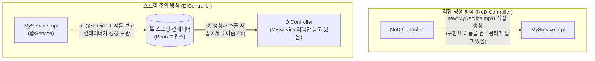
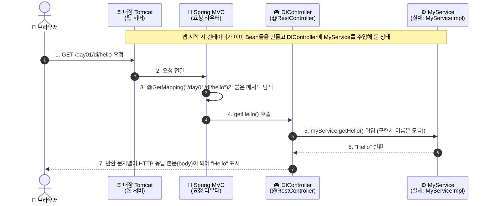

# [실습 & 아키텍처 가이드] 1. Spring Boot 첫걸음 — IoC · DI · 프로젝트 구조 · 설정 파일 누적 실습 가이드

이 문서는 강의 실습 자료(**`08_01_01_과정_오리엔테이션` ~ `08_01_08_설정_파일_확인`**, 총 8교시)를 처음 접하는 학습자가 **`IoC`, `DI`, `Bean`, `Controller → Service` 호출 흐름, `build.gradle.kts`, `application.properties`의 의미를 직접 코드로 만들고 실행하며 이해**하고, 우리의 누적형 실습 프로젝트(`practice_Spring`)에 차곡차곡 쌓아 갈 수 있도록 작성된 **'1번' 실습 & 개념 가이드**입니다.

강의 자료는 "남이 만든 `chapter1` 소스를 **읽고 표를 채우는** 방식"이었지만, 이 가이드는 **같은 내용을 우리 리포지토리에 직접 타이핑하고 실행해 보는 방식**으로 재구성했습니다. (8교시 분량이 모두 빠짐없이 들어 있고, 교시별 대응은 [부록 A](#부록-a-강의-8교시--이-가이드-대응표)에 있습니다.)

구성 순서는 **[초보자 눈높이 IoC/DI 심층 해설] → [환경 준비 & 파일 배치도] → [단계별 소스코드 및 한 줄 해설] → [설정 파일 실험] → [9단계 동작 검증 미션] → [자주 겪는 오류 & 선택 도전 과제 풀이]** 입니다.

---

## 📌 목차

1. [초반 개념 완벽 정복: 왜 스프링이 객체를 대신 만들어 주는가?](#1-초반-개념-완벽-정복-왜-스프링이-객체를-대신-만들어-주는가)
   - 1-1. `new`로 직접 만들면 무엇이 불편할까? (IoC/DI의 등장 배경)
   - 1-2. 레스토랑 비유로 단번에 이해하는 스프링 핵심 용어 8총사
   - 1-3. 눈으로 따라가는 요청 흐름 (브라우저 주소 입력부터 응답까지 7단계)
   - 1-4. 스프링 vs 스프링 부트: 부트가 대신 해주는 일
   - 1-5. 가장 많이 헷갈리는 3가지 핵심 원리 (인터페이스 선언 vs 구현체 생성, `@Autowired` 생략, 컴포넌트 스캔 범위)
2. [사전 준비: JDK · Gradle Wrapper · 네트워크 · 포트](#2-사전-준비-jdk--gradle-wrapper--네트워크--포트)
3. [프로젝트 구조 및 누적 실습 규칙 (`[신규]`, `[수정]`, `(유지)`)](#3-프로젝트-구조-및-누적-실습-규칙-신규-수정-유지)
4. [Step 1: 계약과 이행 만들기 — Service 계층 (`MyService`, `MyServiceImpl`)](#step-1-계약과-이행-만들기--service-계층-myservice-myserviceimpl)
5. [Step 2: 직접 생성 vs 주입 비교 — Controller 4종](#step-2-직접-생성-vs-주입-비교--controller-4종)
6. [Step 3: 프로젝트 재료표 읽기 — `build.gradle.kts` 와 main 클래스](#step-3-프로젝트-재료표-읽기--buildgradlekts-와-main-클래스)
7. [Step 4: 실행하고 두 URL 호출하기](#step-4-실행하고-두-url-호출하기)
8. [Step 5: 설정 파일 실험 — `application.properties`로 포트 바꿨다 되돌리기](#step-5-설정-파일-실험--applicationproperties로-포트-바꿨다-되돌리기)
9. [Step 6: 오늘의 핵심 미션 — 9단계 동작 검증 & 자동 테스트](#step-6-오늘의-핵심-미션--9단계-동작-검증--자동-테스트)
10. [강사의 팁 — 자주 겪는 오류 8선 & 이해도 확인 Q&A (Q1~Q5)](#10-강사의-팁--자주-겪는-오류-8선--이해도-확인-qa-q1q5)
11. [🚀 선택 도전 과제 3종 구현 가이드 (정답 예시 포함)](#-선택-도전-과제-3종-구현-가이드-정답-예시-포함)
12. [🗺️ [미리보기] 내일(2일차)부터 이 구조에 실습을 이어 붙이는 법](#-미리보기-내일2일차부터-이-구조에-실습을-이어-붙이는-법)
- [부록 A. 강의 8교시 ↔ 이 가이드 대응표](#부록-a-강의-8교시--이-가이드-대응표)

---

## 1. 초반 개념 완벽 정복: 왜 스프링이 객체를 대신 만들어 주는가?

스프링을 처음 배울 때 가장 막막한 이유는 **`IoC`, `DI`, `Bean`, `Container`, `@Service`, `@Autowired`** 같은 낯선 용어가 한꺼번에 쏟아지기 때문입니다.
코드를 한 줄이라도 짜기 전에, **"왜 이런 구조가 나왔는지"**부터 비유와 그림으로 먼저 이해해 봅시다.

---

### 💡 1-1. `new`로 직접 만들면 무엇이 불편할까? (IoC/DI의 등장 배경)

지금까지 자바에서는 필요한 객체를 쓰는 쪽이 `new`로 **직접 만들어** 썼습니다. 이번 실습의 `NoDIController`가 딱 그 모습입니다.

```java
private final MyService service = new MyServiceImpl();   // 👈 이 한 줄에 '생성'과 '사용'이 같이 붙어 있다!
```

이 한 줄에는 **두 가지 책임**이 섞여 있습니다.

| 책임 | 이 한 줄에서의 모습 |
| :--- | :--- |
| **사용** 책임 | `MyService service` — 컨트롤러는 "인사말을 주는 서비스"가 필요하다 (인터페이스 타입으로 선언) |
| **생성** 책임 | `new MyServiceImpl()` — **어떤 구현체를 쓸지** 컨트롤러가 직접 정해 버렸다 |

나중에 `MyServiceImpl2`로 갈아 끼우고 싶다면 `new MyServiceImpl()`이 박힌 **모든 컨트롤러를 일일이 열어 고쳐야** 합니다. 반면 스프링에게 맡기면 컨트롤러는 **"MyService 하나 주세요"**라고만 말하고, 어떤 구현체를 넣을지는 **밖(스프링 컨테이너)**이 정합니다.



1. **IoC (Inversion of Control, 제어의 역전)**: 객체를 **만들고 연결하는 주도권이 내 코드에서 프레임워크로 넘어간 것**. ("내가 `new` 한다" → "스프링이 만들어서 준다")
2. **DI (Dependency Injection, 의존성 주입)**: IoC를 실현하는 구체적인 방법. 필요한 객체(의존성)를 **밖에서 넣어주는 것**.
3. 결과적으로 `DIController`는 파일 어디에도 `MyServiceImpl`이라는 이름이 없고, **구현체를 바꿔도 컨트롤러는 한 줄도 안 고쳐도 됩니다.**

> [!NOTE]
> **의존성이란?** "이 클래스가 일을 하려고 사용하는 객체"입니다. `NoDIController`의 의존성은 `MyService`(와 그걸 만들기 위한 `MyServiceImpl`), `DIController`의 의존성은 `MyService`입니다. 위 계층(Controller)일수록 아는 것이 많고, 아래 계층(Service)은 자기를 누가 쓰는지 몰라도 됩니다.

---

### 💡 1-2. 레스토랑 비유로 단번에 이해하는 스프링 핵심 용어 8총사

스프링의 8가지 핵심 용어를 **'레스토랑(Restaurant)'**과 **'React 경험'**에 비유하면 단숨에 이해됩니다.

| 용어 | 레스토랑 비유 🍽️ | React 비유 ⚛️ | 이번 실습의 실제 코드 |
| :--- | :--- | :--- | :--- |
| **`Bean`** | 주방에서 **이미 만들어져 대기 중인 요리 재료/직원** (스프링이 관리하는 객체) | `Provider`에 등록돼 있는 context 값 | `MyServiceImpl` 객체 1개 (기본은 앱 전체에서 **싱글톤 1개**) |
| **`Container`** (`ApplicationContext`) | 모든 Bean을 **보관·조립해 주는 주방 총괄** | `store` / `Provider` | `SpringApplication.run(...)`이 띄우는 것 |
| **`IoC`** | "재료 손질은 내가 안 하고 **주방에 맡긴다**"는 운영 원칙 | "상태 관리는 컴포넌트가 아니라 store에 맡긴다" | `new MyServiceImpl()` 삭제 |
| **`DI`** | 주방이 **주문한 테이블(Controller)에 재료를 직접 가져다줌** | `useSelector`로 필요한 값을 받아옴 | `DIController(MyService myService)` 생성자 |
| **`@Service`** | 이 직원에게 **"주방 직원 명찰"**을 달아 줌 → "이 클래스를 컨테이너가 관리해라" | — | `@Service class MyServiceImpl` |
| **`@RestController`** | **홀 담당 서버(웨이터)** 명찰: 손님(HTTP 요청)을 받고 결과를 **문자열/JSON으로 바로 응답** | 라우트에 연결된 페이지 컴포넌트 | `@RestController class DIController` |
| **`@GetMapping("/경로")`** | 웨이터 중 **"이 테이블 번호(URL) 주문은 내가 받는다"** | `<Route path="/경로">` | `@GetMapping("/day01/di/hello")` |
| **`@SpringBootApplication`** | **개업 신고서**: "여기서부터 아래 폴더를 훑어서 명찰 달린 직원을 모두 채용해라" + 자동 설정 | `main.tsx`의 `createRoot(...).render()` | `PracticeSpringApplication` 클래스 위 |

> [!IMPORTANT]
> **가장 핵심이 되는 한 문장 요약**:
> 스프링 앱에서 **① 클래스에 명찰(`@Service`, `@RestController` …)을 달면 → ② 컨테이너가 시작할 때 그 클래스를 찾아 Bean으로 만들어 보관하고 → ③ 다른 Bean이 "이 타입 하나 주세요"(생성자 파라미터 등)라고 요청하면 알아서 꽂아줍니다.**
> 우리는 `new`를 쓰지 않고 **"명찰 달기 + 필요한 타입 선언하기"**만 합니다.

---

### 💡 1-3. 눈으로 따라가는 요청 흐름 (브라우저 주소 입력부터 응답까지 7단계)

브라우저에서 `http://localhost:8080/day01/di/hello`를 열었을 때 내부에서 벌어지는 일입니다.



#### 🔄 8일 파이프라인에서 '오늘 있는 칸'은 어디까지?

강의는 8일 뒤 `요청 → Controller → Service → Repository → DB → 응답` 전체 그림을 완성하는 것이 목표입니다. **오늘 우리가 가진 칸**은 다음과 같습니다.

| 단계 | 오늘 대응 파일 | 상태 |
| :--- | :--- | :---: |
| 요청 | 브라우저/`curl`이 보내는 `GET /day01/...` (소스 파일 아님) | ✅ (소스 없음) |
| Controller | `day01_di/controller/DIController.java`, `NoDIController.java` | ✅ |
| Service | `day01_di/service/MyService.java`, `MyServiceImpl.java` | ✅ |
| Repository | — (폴더·파일 모두 없음) | ❌ 없음 |
| DB | — (설정도 의존성도 없음) | ❌ 없음 |
| 응답 | 컨트롤러가 반환하는 문자열 `"Hello"` | ✅ |

> 도착점인 `POST /product`(JSON → DB 저장 → 응답)가 **오늘 안 되는 이유 3가지**: ① Repository 계층이 없다, ② DB 연결이 없다(의존성·설정 모두 없음), ③ `POST`를 받는 매핑이 없다(오늘 쓴 건 `@GetMapping` 뿐). 앞으로의 실습이 이 세 칸을 채워 나갑니다.

---

### 💡 1-4. 스프링 vs 스프링 부트: 부트가 대신 해주는 일

| 구분 | 순수 스프링 (Spring Framework) | 스프링 부트 (Spring Boot) |
| :--- | :--- | :--- |
| 의존성 선택 | 라이브러리를 **버전까지 하나하나 직접 조합** | **starter** 한 줄로 검증된 묶음을 가져옴 |
| 서버 | 별도 Tomcat 설치 후 배포(WAR) | **내장 Tomcat** — `main`만 실행하면 서버가 뜸 |
| 설정 | XML/Java 설정을 대량으로 직접 작성 | **자동 설정(Auto-configuration)** + 기본값 |
| 실행 | 서버에 올려야 함 | 그냥 `main` 실행 (또는 `bootRun`) |

강의 자료에서는 이를 **Boot 프로젝트의 `pom.xml`(`chapter1`)** vs **Boot를 안 쓰는 `pom.xml`(`chapter2_design_pattern`)** 로 대조했습니다. 우리 리포지토리는 Maven이 아니라 **Gradle**을 쓰므로 같은 개념이 다음처럼 대응됩니다.

| 개념 | 강의 (Maven `pom.xml`) | 우리 리포지토리 (Gradle `build.gradle.kts`) |
| :--- | :--- | :--- |
| Boot 버전·기본 설정 상속 | `<parent>` → `spring-boot-starter-parent` | `plugins { id("org.springframework.boot") version "4.1.1" }` |
| 의존성 버전 일괄 관리 | parent가 관리 | `id("io.spring.dependency-management")` 플러그인 |
| 웹(내장 서버 + MVC) | `spring-boot-starter-web` | `spring-boot-starter-webmvc` |
| 테스트 묶음 | `spring-boot-starter-test` | `spring-boot-starter-webmvc-test` |
| 자바 버전 | `<java.version>17</java.version>` | `java { toolchain { languageVersion = JavaLanguageVersion.of(21) } }` |
| 빌드 래퍼 | `mvnw`, `mvnw.cmd` | `gradlew`, `gradlew.bat` |
| 빌드 산출물 폴더 | `target/` | `build/` |

> [!TIP]
> 이름 끝의 단어가 역할입니다. `starter-parent`는 **상속(기본값 제공)**, `starter-web(mvc)`는 **웹 기능**, `starter-test`는 **테스트 도구**입니다. starter가 한 줄이면 필요한 라이브러리 수십 개가 같이 들어옵니다.

---

### 💡 1-5. 가장 많이 헷갈리는 3가지 핵심 원리

#### ① 왜 "인터페이스로 선언하고 구현체로 생성"하는데 컴파일이 되나?
```java
private MyService service = new MyServiceImpl();
//      ↑ 선언 타입(왼쪽)        ↑ 생성 타입(오른쪽)  — 이름이 다른데도 OK!
```
- `MyServiceImpl`이 `implements MyService` 이므로 **`MyServiceImpl` 객체는 `MyService` 타입 변수에 담길 수 있습니다.** 자바의 다형성이며 스프링과는 아직 무관합니다.
- **계약(인터페이스)**: `MyService` — 메서드 이름과 반환 타입만 있음. **이행(구현체)**: `MyServiceImpl` — 실제로 무엇을 돌려줄지(`"Hello"`)가 있음.

#### ② 생성자가 하나뿐이면 `@Autowired`를 생략해도 된다!
```java
// 우리 DIController — @Autowired 없음. 그래도 주입된다!
public DIController(MyService myService) { this.myService = myService; }
```
- 스프링 4.3+ 부터 **생성자가 단 하나면 `@Autowired` 생략 가능**합니다. (강의 교재는 학습용으로 명시했지만 실무에서는 생략이 일반적입니다.)
- 반면 **필드 주입·setter 주입은 `@Autowired`가 필수**입니다. 필드/메서드는 스프링이 "여기에 넣어야 하나?"를 알 방법이 없기 때문입니다.
- `NoDIController`에 `@Autowired`가 없는 이유는 **스프링에게 부탁하지 않고 스스로 만들기 때문**입니다.

#### ③ `@SpringBootApplication`은 "자기 패키지 **아래쪽만**" 훑는다 (컴포넌트 스캔)
```text
org.example.practice_spring                  ← PracticeSpringApplication (main) 이 여기 있음 → 여기서부터 아래를 스캔
org.example.practice_spring.day01_di.controller   ✅ 스캔 대상 (아래쪽)
org.example.practice_spring.day01_di.service      ✅ 스캔 대상 (아래쪽)
```
- **main 클래스는 모든 실습 패키지의 '상위 패키지'에 있어야** 합니다. 이번 누적 구조가 `org.example.practice_spring.dayXX_주제` 형태인 이유입니다.
- 만약 main 클래스를 `...day01_di.controller` 안으로 옮기면 `...day01_di.service`는 **그 아래가 아니므로 스캔 범위 밖**이 되어 `MyService` Bean을 못 찾고 앱이 뜨지 않습니다. (도전 과제 ③에서 직접 확인합니다.)

---

## 2. 사전 준비: JDK · Gradle Wrapper · 네트워크 · 포트

우리 프로젝트(`practice_Spring`)는 이미 IntelliJ(Spring Initializr)로 생성되어 있으므로 **추가 설치할 패키지는 없습니다.** 대신 아래 4가지가 갖춰졌는지 확인하세요. (강의 5교시의 "환경 확정" 단계입니다.)

| # | 확인 항목 | 확인 방법 | 우리 환경의 기준 |
| :-: | :--- | :--- | :--- |
| ① | **JDK 21** | `java -version` | `build.gradle.kts`의 toolchain이 **21**을 요구. 설치된 버전이 더 높아도 무방, **낮으면 안 됨** |
| ② | **Gradle Wrapper** | 프로젝트 루트의 `gradlew`, `gradlew.bat` | `mvn`/`gradle`을 따로 설치하지 않고 **wrapper로 실행** |
| ③ | **인터넷** | 첫 빌드 시 Gradle 배포본 + 의존성 다운로드 | `gradle/wrapper/gradle-wrapper.properties`의 `distributionUrl`이 **`https://...` 원격 주소**이므로 첫 빌드엔 네트워크 필수 |
| ④ | **8080 포트 비어 있음** | 아래 명령 | 이미 쓰는 프로그램이 있으면 앱이 못 뜸 |

```powershell
# ① JDK 버전 확인 (PATH에 java가 없다면 IntelliJ의 JDK를 쓰면 됩니다 — IntelliJ에서 실행하는 경우는 자동)
java -version

# ② 프로젝트 루트에서 wrapper 동작 확인 (처음 1회는 Gradle 배포본을 내려받느라 오래 걸립니다)
.\gradlew.bat --version

# ④ 8080 포트를 누가 쓰고 있는지 확인
netstat -ano | findstr :8080
```

> [!NOTE]
> **Windows vs macOS/Linux**: Windows는 `.\gradlew.bat`, macOS/Linux는 `./gradlew`입니다. 강의의 "`mvnw`에 실행 권한(`x`)이 없어 `Permission denied`" 문제는 macOS/Linux 한정이고, 우리 리포지토리는 `.gitattributes`로 `gradlew`의 줄바꿈(LF)을 고정해 두었습니다. Windows에서는 해당 없습니다.

> [!WARNING]
> **빌드 실패와 포트 충돌은 서로 다른 '단계'의 문제입니다.**
>
> | 문제 | 언제 나타나는가 | 소스를 고쳐야 하나 | 첫 확인 대상 |
> | :--- | :--- | :--- | :--- |
> | **빌드 실패** | 빌드 중 (컴파일/의존성 다운로드) | 대개 예 (또는 환경: JDK·네트워크) | `build.gradle.kts`, `java -version` |
> | **8080 포트 충돌** | 실행 중 (서버 기동 시) | 아니오 (소스 문제 아님) | `netstat -ano \| findstr :8080`, 또는 `application.properties`의 `server.port` |

---

## 3. 프로젝트 구조 및 누적 실습 규칙 (`[신규]`, `[수정]`, `(유지)`)

### 🏗️ 누적 실습 4대 규칙

앞으로 모든 실습을 이 리포지토리에 **충돌 없이 겹쳐 쌓기** 위한 약속입니다. (React 프로젝트의 `practices/registry.ts` 역할을 스프링은 **"패키지 + URL 접두어"** 로 해결합니다.)

| # | 규칙 | 이유 |
| :-: | :--- | :--- |
| ① | 실습 1개 = **`org.example.practice_spring.dayXX_주제`** 패키지 1개 (예: `day01_di`) | main 클래스(`org.example.practice_spring`)의 **하위 패키지**라 컴포넌트 스캔이 자동으로 모든 실습을 잡아 준다. **main 클래스는 절대 옮기지 않는다** |
| ② | 그 패키지 안에서는 **`controller/`, `service/`, (이후) `repository/`, `domain/`** 로 계층별 폴더 분리 | 강의의 레이어드 아키텍처와 동일한 모양을 유지 |
| ③ | URL은 반드시 **`/dayXX/...`** 접두어를 붙인다 (예: `/day01/di/hello`) | 실습끼리 URL이 겹쳐 `Ambiguous mapping` 오류가 나는 것을 방지 |
| ④ | 테스트도 같은 구조로 `src/test/java/.../dayXX_주제/` 에 둔다 | 실습별로 "동작한다"를 자동 검증 |

> [!CAUTION]
> **Bean 이름 충돌 주의**: 서로 다른 패키지에 **같은 클래스 이름**(예: 두 실습 모두에 `MyServiceImpl`)을 만들면 기본 Bean 이름(`myServiceImpl`)이 같아져 `ConflictingBeanDefinitionException`으로 앱이 뜨지 않습니다. 새 실습의 클래스 이름은 `Day02HelloService`처럼 **겹치지 않게** 짓거나 `@Service("day02MyService")`로 이름을 지정하세요.

### 📂 이번 실습 파일 배치도

```text
practice_Spring/
 ├── build.gradle.kts                                   (기존 유지) 재료표: Boot 4.1.1 / Java 21 / webmvc starter
 ├── settings.gradle.kts                                (기존 유지) 프로젝트 이름 practice_spring
 ├── gradlew, gradlew.bat, gradle/wrapper/              (기존 유지) Gradle Wrapper
 ├── docs/
 │    └── guide/
 │         └── 1.SPRING_DAY01_IOC_DI_AND_BOOT_BASICS_GUIDE.md   [신규 생성] 본 가이드북
 └── src/
      ├── main/
      │    ├── java/org/example/practice_spring/
      │    │    ├── PracticeSpringApplication.java            (기존 유지) ★ main 클래스 — 모든 실습의 상위 패키지
      │    │    │
      │    │    └── day01_di/                                 [신규 생성] 08_01 (1일차) 실습 전용 패키지
      │    │         ├── controller/
      │    │         │    ├── NoDIController.java              [신규] 예제 1.1 직접 생성        GET /day01/no-di/hello
      │    │         │    ├── DIController.java                [신규] 예제 1.2 생성자 주입      GET /day01/di/hello
      │    │         │    ├── FieldInjectionController.java    [신규] 예제 1.3 필드 주입        (URL 없음)
      │    │         │    └── SetterInjectionController.java   [신규] 예제 1.4 setter 주입      (URL 없음)
      │    │         └── service/
      │    │              ├── MyService.java                   [신규] 계약(인터페이스)
      │    │              └── MyServiceImpl.java               [신규] 이행(구현체, @Service)
      │    └── resources/
      │         └── application.properties                     [Step 5에서 임시 수정 후 복구]
      └── test/
           └── java/org/example/practice_spring/
                ├── PracticeSpringApplicationTests.java        (기존 유지) contextLoads
                └── day01_di/
                     └── Day01DiTest.java                      [신규 생성] 1일차 자동 검증
```

> [!TIP]
> 강의의 `com.wikibooks.chapter1` 패키지는 우리의 `org.example.practice_spring.day01_di` 에 **1:1 대응**됩니다. 단, URL은 `/no-di/hello` → `/day01/no-di/hello` 처럼 접두어를 붙였습니다(규칙 ③).

---

## Step 1: 계약과 이행 만들기 — Service 계층 (`MyService`, `MyServiceImpl`)

### 📌 파일 역할 (강의 1·2교시 대응)
컨트롤러가 의존하게 될 **서비스의 계약(인터페이스)** 과 **이행(구현체)** 을 만듭니다. 구현체에 **`@Service`** 를 붙여 스프링 컨테이너가 Bean으로 관리하게 합니다.

- **위치**: `src/main/java/org/example/practice_spring/day01_di/service/` (`[신규 생성]`)

#### 1-1. 계약 — `MyService.java`
```java
package org.example.practice_spring.day01_di.service;

/** 계약(인터페이스): "무엇을 할 수 있는가"만 선언한다. */
public interface MyService {

    String getHello();

}
```

#### 1-2. 이행 — `MyServiceImpl.java`
```java
package org.example.practice_spring.day01_di.service;

import org.springframework.stereotype.Service;

/** 이행(구현체): @Service 가 붙어 있어야 스프링 컨테이너가 Bean 으로 관리한다. */
@Service
public class MyServiceImpl implements MyService {

    @Override
    public String getHello() {
        return "Hello";   // 앞으로 여러 교시에서 계속 확인하게 될 문자열
    }

}
```

### 🔍 코드 읽기 포인트
1. **인터페이스에는 "이름과 반환 타입"만, 구현체에는 "실제 반환값"이 있다.** 이 분리가 곧 "계약과 이행"입니다.
2. **`@Service`를 지우면?** (⚠️ *실제로 지우지 말고 예측만*) `MyService`는 인터페이스라 스프링이 직접 만들 수 없고, "관리 대상으로 표시된 구현체"를 찾아 넣습니다. 표시가 없으면 `DIController`가 요구하는 `MyService` 타입의 Bean이 하나도 없어 **`No qualifying bean of type 'MyService'`** 오류로 앱이 뜨지 않습니다. (도전 과제 ②에서 안전하게 직접 확인합니다.)
3. 이 서비스에는 `if`도, 외부 입력도 없습니다. 그래서 **실행하지 않고도 반환값이 `"Hello"`로 확정**됩니다.
4. `MyServiceImpl`은 `org.springframework.web...` 같은 **HTTP 관련 import가 하나도 없습니다.** Service는 HTTP를 몰라도 됩니다(= 웹이 아닌 곳에서도 재사용 가능).

---

## Step 2: 직접 생성 vs 주입 비교 — Controller 4종

### 📌 파일 역할 (강의 1·2·4·7교시 대응)
같은 `MyService`를 **서로 다른 4가지 방법**으로 받는 컨트롤러를 만들어 비교합니다. 이 중 **URL이 있는 것은 2개**뿐입니다.

- **위치**: `src/main/java/org/example/practice_spring/day01_di/controller/` (`[신규 생성]`)

#### 2-1. 직접 생성 — `NoDIController.java` (예제 1.1)
```java
package org.example.practice_spring.day01_di.controller;

import org.example.practice_spring.day01_di.service.MyService;
import org.example.practice_spring.day01_di.service.MyServiceImpl;
import org.springframework.web.bind.annotation.GetMapping;
import org.springframework.web.bind.annotation.RestController;

// 예제 1.1 일반적인 자바 코드에서의 객체 사용법 (DI 없음)
@RestController
public class NoDIController {

    // 선언은 인터페이스, 생성은 구현체 -> 생성 책임과 사용 책임이 한 줄에 붙어 있다.
    private final MyService service = new MyServiceImpl();

    @GetMapping("/day01/no-di/hello")
    public String getHello() {
        return service.getHello();
    }

}
```

#### 2-2. 생성자 주입 — `DIController.java` (예제 1.2, ⭐ 권장)
```java
package org.example.practice_spring.day01_di.controller;

import org.example.practice_spring.day01_di.service.MyService;
import org.springframework.web.bind.annotation.GetMapping;
import org.springframework.web.bind.annotation.RestController;

// 예제 1.2 생성자를 통한 의존성 주입 (권장 방식)
@RestController
public class DIController {

    private final MyService myService;

    // 생성자가 하나뿐이면 @Autowired 생략 가능. 구현체(MyServiceImpl)의 이름이 이 파일에 없다.
    public DIController(MyService myService) {
        this.myService = myService;
    }

    @GetMapping("/day01/di/hello")
    public String getHello() {
        return myService.getHello();
    }

}
```

#### 2-3. 필드 주입 — `FieldInjectionController.java` (예제 1.3)
```java
package org.example.practice_spring.day01_di.controller;

import org.example.practice_spring.day01_di.service.MyService;
import org.springframework.beans.factory.annotation.Autowired;
import org.springframework.web.bind.annotation.RestController;

// 예제 1.3 필드 주입: 간단하지만 final 불가, 테스트에서 가짜 객체를 넣을 통로가 없다.
@RestController
public class FieldInjectionController {

    @Autowired
    private MyService myService;

    // 매핑(@GetMapping)이 없으므로 URL 로는 접근할 수 없다. 주입 문법만 보여 주는 예제.
    public MyService getMyService() {
        return myService;
    }

}
```

#### 2-4. setter 주입 — `SetterInjectionController.java` (예제 1.4)
```java
package org.example.practice_spring.day01_di.controller;

import org.example.practice_spring.day01_di.service.MyService;
import org.springframework.beans.factory.annotation.Autowired;
import org.springframework.web.bind.annotation.RestController;

// 예제 1.4 setter 주입: 선택적 의존성에 쓰지만 final 불가, 객체가 불완전한 상태로 존재할 수 있다.
@RestController
public class SetterInjectionController {

    private MyService myService;

    @Autowired
    public void setMyService(MyService myService) {
        this.myService = myService;
    }

    public MyService getMyService() {
        return myService;
    }

}
```

> [!NOTE]
> 강의 원본의 필드/setter 컨트롤러에는 `getMyService()` 가 없습니다(주입만 보여 주는 예제). 우리는 **Step 6의 자동 테스트에서 "정말 주입됐는지" 확인**하기 위해 getter를 하나씩 추가했습니다. 그 외 동작은 동일합니다. 또 `NoDIController`/`DIController`의 필드에 `final`을 붙였는데, 이것이 바로 아래 비교표에서 말하는 "생성자 주입은 `final` 가능"의 실제 모습입니다.

### 🔍 코드 읽기 포인트 (2교시 핵심 — 세 가지 주입 방식 비교표)

| 방식 | 의존성이 밖에서 잘 보이는가 | `final`을 붙일 수 있는가 | 테스트에서 가짜 객체를 넣기 쉬운가 |
| :--- | :---: | :---: | :---: |
| **필드** (`@Autowired private ...`) | ❌ 안 보임 (private 필드 안에 숨음) | ❌ 불가 | ❌ 어려움 (넣을 통로가 없음, 리플렉션 필요) |
| **setter** (`@Autowired void setX(...)`) | △ 보임 (메서드) | ❌ 불가 | ✅ 쉬움 (setter 호출) |
| **생성자** (`Controller(MyService s)`) | ✅ 시그니처에 그대로 드러남 | ✅ **가능** | ✅ 쉬움 (`new Controller(가짜)`) |

- 판단 기준은 "**그 객체를 밖에서 넣어 줄 통로가 있는가**"입니다. 필드에 직접 꽂힌 것은 통로가 없습니다.
- 생성자 주입이 권장되는 이유: ① 필수 의존성이 **빠진 채로 객체가 존재할 수 없고** ② `final`로 **불변** 보장 ③ **테스트가 쉽습니다.**
- "`final`을 붙일 수 **있다**"와 "붙어 **있다**"는 다릅니다. (강의 원본 소스에는 `final`이 0건이었습니다. 우리 코드는 붙였으니 `grep` 결과가 다를 수 있고, 그 사실을 그대로 기록하는 것이 이 미션의 요점입니다.)

#### 🔎 강의 2교시 검색 미션 — 우리 코드로 다시 해보기 (PowerShell)
```powershell
# @Autowired 애너테이션이 붙은 곳 (import 줄 제외) — 예상: FieldInjection, SetterInjection 2곳
Select-String -Path "src\main\java\org\example\practice_spring\day01_di\controller\*.java" -Pattern "@Autowired" | Where-Object { $_.Line -notmatch "^import" }

# DIController 안에 구현체 이름이 나오는가? — 예상: 0건 (구현체 이름을 모른다!)
Select-String -Path "src\main\java\org\example\practice_spring\day01_di\controller\DIController.java" -Pattern "MyServiceImpl"
```

---

## Step 3: 프로젝트 재료표 읽기 — `build.gradle.kts` 와 main 클래스

### 📌 파일 역할 (강의 3·6·7교시 대응)
이 단계는 **새 파일을 만들지 않고 이미 있는 두 파일을 읽는** 단계입니다.

#### 3-1. 재료표 — `build.gradle.kts` (`(기존 유지)`)
```kotlin
plugins {
    java
    id("org.springframework.boot") version "4.1.1"          // ① Boot 버전·실행(bootRun)·패키징 담당
    id("io.spring.dependency-management") version "1.1.7"   // ② 의존성 버전을 Boot가 일괄 관리
}

java {
    toolchain { languageVersion = JavaLanguageVersion.of(21) }   // ③ 요구 자바 버전
}

dependencies {
    implementation("org.springframework.boot:spring-boot-starter-webmvc")  // ④ ⭐ "이 프로젝트는 웹이다" — 내장 Tomcat + Spring MVC
    compileOnly("org.projectlombok:lombok")                                // ⑤ 보일러플레이트 코드 자동 생성(롬복)
    annotationProcessor("org.projectlombok:lombok")
    testImplementation("org.springframework.boot:spring-boot-starter-webmvc-test") // ⑥ 테스트 도구 묶음
    ...
}
```
- **④ 한 줄이 없으면** `@RestController`도 `@GetMapping`도 쓸 수 없습니다. "서버는 어디에 있나?"의 답은 별도 설치가 아니라 **이 줄**입니다.
- `starter-parent`(상속) / `starter-webmvc`(웹) / `starter-webmvc-test`(테스트) 처럼 **이름 뒤 단어가 역할**입니다.

#### 3-2. 출발점 — `PracticeSpringApplication.java` (`(기존 유지)`)
```java
package org.example.practice_spring;

@SpringBootApplication
public class PracticeSpringApplication {

    public static void main(String[] args) {
        SpringApplication.run(PracticeSpringApplication.class, args);
    }

}
```

| 구분 | 내용 |
| :--- | :--- |
| 자바 표준 `main`과 **같은** 부분 | `public static void main(String[] args)` 시그니처 그대로 |
| **다른** 부분 ① | `main` 안에서 **`SpringApplication.run(...)`** 을 호출해 컨테이너와 내장 서버를 띄움 |
| **다른** 부분 ② | 클래스 위의 **`@SpringBootApplication`** (컴포넌트 스캔 + 자동 설정) |

`run`에 넘기는 **두 인자**:

| 인자 | 값 | 어디서 왔는가 |
| :---: | :--- | :--- |
| 첫 번째 | `PracticeSpringApplication.class` | **클래스 리터럴** — "이 클래스(와 그 하위 패키지)를 기준으로 시작해라" |
| 두 번째 | `args` | **`main`의 파라미터** — 명령행 옵션(`--server.port=9090` 등)을 스프링이 설정으로 읽어 감 |

> [!TIP]
> 첫 번째 인자가 하필 이 클래스인 이유가 1-5의 ③ 컴포넌트 스캔 범위입니다. "이 클래스의 패키지가 스캔의 **출발점**"이기 때문입니다.

---

## Step 4: 실행하고 두 URL 호출하기

### 📌 실행 방법 (둘 중 편한 것)

**방법 A. IntelliJ**: `PracticeSpringApplication` 클래스의 ▶ 버튼 → Run.
**방법 B. 터미널** (프로젝트 루트):
```powershell
.\gradlew.bat bootRun
```

정상이라면 로그 끝에 이런 줄이 보입니다.
```text
Tomcat started on port 8080 (http) with context path '/'
Started PracticeSpringApplication in 1.4 seconds
```

### 📌 URL 호출
```powershell
curl http://127.0.0.1:8080/day01/no-di/hello    # → Hello
curl http://127.0.0.1:8080/day01/di/hello       # → Hello
curl -i http://127.0.0.1:8080/di/hello          # → 404 (접두어 없는 옛 주소는 없다)
```
(브라우저 주소창에 입력해도 됩니다.)

### 🔍 결과 해석
- **두 URL이 같은 `"Hello"` 를 돌려줍니다.** 결과가 같으니 **결과만으로는 구조의 좋고 나쁨을 평가할 수 없습니다.** 차이는 *구현체를 바꿀 때 드는 비용*에서 드러납니다.
- 접근 가능한 URL은 **딱 2개**입니다. `FieldInjectionController`, `SetterInjectionController`는 `@RestController`는 붙어 있지만 **매핑이 없어** URL로는 닿지 않습니다. 요청을 받으려면 **두 조건이 모두 필요**합니다.
  - ① 클래스가 컨트롤러로 등록될 것 (`@RestController`) ② 메서드에 경로가 매핑될 것 (`@GetMapping`)
- `@RestController` 4곳 vs `@GetMapping` 2곳 — 숫자가 다른 이유가 바로 이 두 클래스입니다.

#### 🧭 `GET /day01/di/hello` 한 건 추적 (파일 단위 4단계)

| 단계 | 무엇 | 근거 코드 한 줄 |
| :---: | :--- | :--- |
| ① 진입 클래스 | `DIController` | `@GetMapping("/day01/di/hello")` |
| ② 호출되는 메서드 | `getHello()` | `public String getHello() {` |
| ③ 위임하는 타입 | `MyService` (인터페이스) | `private final MyService myService;` |
| ④ 문자열을 만드는 클래스 | `MyServiceImpl` (구현 클래스) | `return "Hello";` |

③이 인터페이스 타입, ④가 구현 클래스입니다. 이 둘이 다르다는 것이 "계약과 이행"입니다.

#### 💰 구현체를 갈아 끼우는 비용 (종이 위 판정 — *실제로 `MyServiceImpl2`를 만들지 마세요*)
`MyService`의 새 구현체 `MyServiceImpl2`로 교체한다고 가정하면:

| 클래스 | 고쳐야 하는 파일 | 고쳐야 하는 줄 | 고칠 곳 개수 |
| :--- | :--- | :--- | :---: |
| `NoDIController` | 컨트롤러 파일 | `new MyServiceImpl()` → `new MyServiceImpl2()` (**사용하는 컨트롤러마다**) | 컨트롤러 수만큼 |
| `DIController` | **컨트롤러는 0줄!** | 대신 **구현체 쪽** `MyServiceImpl2`에 `@Service`를 달고 기존 것에서 떼기(또는 `@Primary`) | 구현체 파일 쪽 1~2곳 |

→ **DI 쪽이 훨씬 적게 고칩니다.** 컨트롤러가 구현체 이름을 모르기 때문입니다.

---

## Step 5: 설정 파일 실험 — `application.properties`로 포트 바꿨다 되돌리기

### 📌 파일 역할 (강의 6·8교시 대응)
**소스 코드를 한 줄도 고치지 않고** 실행 환경(포트)을 바꾸는 지점이 어디인지 체험합니다.

- **위치**: `src/main/resources/application.properties` (`[임시 수정 후 반드시 복구]`)
- 현재 내용(이미 있음): `spring.application.name=practice_spring` — 강의 원본은 빈 파일이었지만 우리는 Initializr가 앱 이름 한 줄을 넣어 두었습니다.

> [!IMPORTANT]
> 이 단계는 파일을 실제로 고칩니다. **우리는 Git이 있으므로** 강의의 "건수 기록" 대신 `git diff` / `git restore` 로 안전하게 복구 여부를 검증합니다. (그래도 강의 방식의 `Select-String` 건수 기록도 함께 해 보세요.)

### 🧪 5단계 실험 절차

**① 기준선 기록** (수정 전)
```powershell
(Select-String -Path src\main\resources\application.properties -Pattern "server.port").Count   # → 0
(Get-Item src\main\resources\application.properties).Length                                       # 바이트 수 기록
```
> `Select-String` 결과가 없으면 `.Count`는 0입니다. 오류가 아닙니다. (강의의 `grep -c` 가 0을 출력하는 것과 같음)

**② 한 줄 추가**
```properties
spring.application.name=practice_spring
server.port=8081
```

**③ 재실행 후 관측** — 로그가 `Tomcat started on port 8081` 로 바뀌고, 이제 주소가 `http://127.0.0.1:8081/day01/di/hello` 가 됩니다. (8080은 더 이상 응답하지 않음)

**④ 되돌리기 (필수)** — 추가한 `server.port=8081` 줄을 **주석 처리가 아니라 줄 자체를 삭제**하고 저장합니다.

**⑤ 복구 확인**
```powershell
git diff -- src/main/resources/application.properties   # → 출력이 없어야 함 (변경 없음). 단, 이 파일이 아직 커밋 전이면 아래 건수 표로 확인
(Select-String -Path src\main\resources\application.properties -Pattern "server.port").Count   # → 0
```

| 시점 | `server.port` 건수 |
| :--- | :---: |
| 수정 전 (①) | 0 |
| 수정 후 (②) | 1 |
| 복구 후 (⑤) | 0 |

**첫 줄과 마지막 줄의 숫자가 같아야 합니다.** 

### 🔍 코드 읽기 포인트
1. **비어 있어도(또는 앱 이름 한 줄뿐이어도) 앱이 뜨는 이유 = "기본값"** 입니다. 부트는 포트 8080 같은 합리적인 **기본값**을 내장하고 있고, `application.properties`는 그 기본값을 **덮어쓰는 선택지**일 뿐입니다.
2. 이 파일로 바꿀 수 있는 대표 항목 4가지: ① 서버 포트(`server.port`) ② 애플리케이션 이름(`spring.application.name`) ③ DB 연결 정보(`spring.datasource.*`) ④ 로그 레벨(`logging.level.*`)
3. 우선순위: **명령행 인자(`--server.port=9090`) > `application.properties`**. IDE 실행 설정에 포트 인자가 들어 있으면 파일을 고쳐도 안 바뀝니다. `main`의 `args`를 `run`에 넘기는 이유가 이것입니다.
4. 주석 처리(`#server.port=8081`)만 하면 문자열이 남아 건수가 1로 계속 잡힙니다. **줄 자체를 지우세요.**

---

## Step 6: 오늘의 핵심 미션 — 9단계 동작 검증 & 자동 테스트

### ✅ 1) 9단계 동작 체크리스트

앱을 `8080`으로 실행한 상태에서(Step 5의 포트 수정은 복구된 상태) 아래를 순서대로 확인하세요.

| 순서 | 사용자 동작 | 예상 결과 (직접 눈으로 확인!) |
| :---: | :--- | :--- |
| **1** | `java -version` / `.\gradlew.bat --version` 실행 | JDK 21 이상, Gradle 정상 출력 |
| **2** | `.\gradlew.bat bootRun` 실행 | 로그에 `Tomcat started on port 8080` |
| **3** | `GET /day01/no-di/hello` | 본문 `Hello` |
| **4** | `GET /day01/di/hello` | 본문 `Hello` (3번과 **같은 값**) |
| **5** | `GET /day01/field/hello` 등 존재하지 않는 주소 | `404` — Field/Setter 컨트롤러엔 매핑이 없음 |
| **6** | `GET /di/hello` (접두어 없는 옛 주소) | `404` |
| **7** | `application.properties`에 `server.port=8081` 추가 후 재시작 | 로그가 `port 8081`, 8080은 응답 없음 |
| **8** | 추가한 줄을 **삭제**하고 재시작 | 다시 `port 8080` (복구 확인) |
| **9** | `.\gradlew.bat test` | `BUILD SUCCESSFUL` (아래 자동 테스트 포함 통과) |

### 🤖 2) 자동 테스트 — `Day01DiTest.java` (`[신규 생성]`)

강의의 `Chapter1ApplicationTests`(본문이 빈 `contextLoads`)는 **"스프링 컨테이너가 정상 기동되는가"** 를 검증합니다. (Bean 누락·순환 참조 등이 있으면 이 테스트가 깨집니다.) 우리는 거기에 1일차 내용을 직접 검증하는 테스트를 더했습니다.

- **위치**: `src/test/java/org/example/practice_spring/day01_di/Day01DiTest.java`

```java
package org.example.practice_spring.day01_di;

import static org.assertj.core.api.Assertions.assertThat;

import org.example.practice_spring.day01_di.controller.DIController;
import org.example.practice_spring.day01_di.controller.FieldInjectionController;
import org.example.practice_spring.day01_di.controller.NoDIController;
import org.example.practice_spring.day01_di.controller.SetterInjectionController;
import org.example.practice_spring.day01_di.service.MyService;
import org.junit.jupiter.api.Test;
import org.springframework.beans.factory.annotation.Autowired;
import org.springframework.boot.test.context.SpringBootTest;

@SpringBootTest
class Day01DiTest {

    @Autowired NoDIController noDiController;
    @Autowired DIController diController;
    @Autowired FieldInjectionController fieldController;
    @Autowired SetterInjectionController setterController;
    @Autowired MyService myService;

    @Test
    void 두_컨트롤러는_같은_문자열을_돌려준다() {
        assertThat(noDiController.getHello()).isEqualTo("Hello");
        assertThat(diController.getHello()).isEqualTo("Hello");
    }

    @Test
    void 세_가지_주입_방식_모두_같은_Bean이_들어온다() {
        assertThat(fieldController.getMyService()).isSameAs(myService);
        assertThat(setterController.getMyService()).isSameAs(myService);
    }

}
```

- **`@SpringBootTest`**: 테스트 시작 시 실제 컨테이너를 띄웁니다. 그래서 테스트 클래스 필드에도 `@Autowired`가 통합니다.
- **`isSameAs`**: `==`(같은 객체인지) 검사입니다. 필드 주입·setter 주입으로 받은 `MyService`가 **컨테이너의 싱글톤 Bean 그 하나**임을 증명합니다. (Bean은 기본이 싱글톤)
- 실행: `.\gradlew.bat test` → `BUILD SUCCESSFUL`. 리포트: `build/reports/tests/test/index.html`

### 🧱 3) 프로젝트 구조 탐색 — 6교시 "네 단계 완주" 기록표

`재료 → 출발점 → URL → 위임 대상` 순서로 한 번 훑으며 채워 보세요. (정답 예시 포함)

| 단계 | 찾을 것 | 값 | 파일 경로 |
| :---: | :--- | :--- | :--- |
| ① | "이 프로젝트는 웹이다"라고 말해 주는 줄 | `spring-boot-starter-webmvc` | `build.gradle.kts` |
| ② | main 클래스의 완전한 이름 | `org.example.practice_spring.PracticeSpringApplication` | `src/main/java/org/example/practice_spring/PracticeSpringApplication.java` |
| ③ | `DIController`의 URL 문자열 | `/day01/di/hello` | `.../day01_di/controller/DIController.java` |
| ④ | 그 URL이 최종 호출하는 메서드의 반환값 | `"Hello"` | `.../day01_di/service/MyServiceImpl.java` |

**`main` 갈래 vs `test` 갈래**:
```text
src/
├── main/
│   ├── java/        → 실제 애플리케이션 코드 (배포 대상)
│   └── resources/   → 설정 파일 등 코드 밖의 자원 (application.properties)
└── test/
    └── java/        → 테스트 코드 (앱 실행 시 함께 실행되지 않음, test 태스크에서만)
```

**의존성은 한 방향으로만 흐른다** (Controller → Service ✅ / Service → Controller ❌):
```powershell
# controller → service 를 import 하는 파일: 여러 개 (정상)
Select-String -Path "src\main\java\org\example\practice_spring\day01_di\controller\*.java" -Pattern "day01_di.service" -List | Select-Object Filename

# service → controller 를 import 하는 파일: 0건이어야 정상
Select-String -Path "src\main\java\org\example\practice_spring\day01_di\service\*.java" -Pattern "day01_di.controller" -List
```
→ 아래 계층은 자기를 누가 쓰는지 몰라도 됩니다. 그래서 **Service만 따로 떼어 테스트**할 수 있습니다.

### 🧾 4) 8교시 마무리 — 세 문장에 근거 달기

| # | 주장 | 근거 파일 경로 | 옮겨 적은 코드 한 줄 |
| :-: | :--- | :--- | :--- |
| ① | 이 프로젝트는 웹 요청을 받는다 | `build.gradle.kts` | `implementation("org.springframework.boot:spring-boot-starter-webmvc")` |
| ② | 서비스 구현체는 스프링이 관리한다 | `.../day01_di/service/MyServiceImpl.java` | `@Service` |
| ③ | `/day01/di/hello` 는 `"Hello"` 를 반환한다 | `.../service/MyServiceImpl.java` (만들어지는 곳) + `.../controller/DIController.java` (위임하는 곳) | `return "Hello";` |

**오늘의 한 문장**: *"`build.gradle.kts`로 재료를 준비하면(**재료 준비**) `main`이 컨테이너와 내장 Tomcat을 띄우고(**컨테이너·서버 기동**) 컨테이너가 `@Service` 구현체를 `DIController`에 주입해 연결하며(**Controller와 Service 연결**) 컨트롤러가 반환한 문자열이 HTTP 응답이 된다(**HTTP 응답**)."*

---

## 10. 강사의 팁 — 자주 겪는 오류 8선 & 이해도 확인 Q&A (Q1~Q5)

### 🩺 자주 겪는 오류 8선 (트러블슈팅 표)

| 증상 | 확인할 원인 | 해결 방향 |
| :--- | :--- | :--- |
| **`Port 8080 was already in use`** (앱이 안 뜸) | 이미 8080을 쓰는 다른 프로그램(다른 서버·이전에 띄운 앱)이 있음. **소스 문제가 아님** | `netstat -ano \| findstr :8080`로 PID 확인 후 종료하거나 `server.port`를 다른 값으로 변경 |
| **`curl localhost:8080/...`가 `404 File not found`인데 내 앱 로그는 정상** | `localhost`는 IPv6(`::1`)로 먼저 연결될 수 있어, **IPv6 쪽 8080을 쓰는 다른 서버**가 대신 응답함 | `127.0.0.1`로 호출하거나 `netstat`으로 8080을 여러 프로세스가 쓰는지 확인. **응답 에러 페이지의 모양이 스프링 것이 아니라면 다른 서버**임 |
| **`No qualifying bean of type '...MyService'`** | 구현체에 `@Service`가 없거나, 구현체가 **스캔 범위 밖**(main 클래스의 하위 패키지가 아님)에 있음 | 구현체에 `@Service` 확인, main 클래스 위치/패키지 확인 |
| **`NoUniqueBeanDefinitionException`** (`expected single matching bean but found 2`) | `MyService` 구현체가 `@Service`로 **둘 이상** 등록됨 | 하나만 남기거나 `@Primary` / `@Qualifier`로 지정 (도전 과제 ①) |
| **`ConflictingBeanDefinitionException`** | 다른 패키지에 **같은 클래스 이름**의 Bean이 있음 (누적 실습에서 주의!) | 클래스 이름을 겹치지 않게 변경하거나 `@Service("고유이름")` |
| **URL을 호출하면 `404`** | ① `@GetMapping` 경로 오타 ② 매핑이 아예 없는 컨트롤러(Field/Setter) ③ `/day01` 접두어 누락 | 4교시 URL 목록(딱 2개) 대조, 앱 재시작 여부 확인 |
| **`Unsupported class file major version` / `Could not target platform: Java 21`** | JDK가 21보다 **낮은** 버전으로 실행됨 | `JAVA_HOME` 또는 IntelliJ의 Project SDK/Gradle JVM을 21로 설정 |
| **`gradlew` 첫 실행이 멈춘 듯 오래 걸림 / 실패** | wrapper가 Gradle 배포본(원격 주소)을 내려받는 중, 또는 네트워크 차단 | 몇 분 기다리거나 네트워크 확인. 5분 넘게 진행 없으면 Ctrl+C 후 IntelliJ의 Gradle 동기화로 시도 |

### 🎓 이해도 확인 Q&A

**Q1. `private MyService service = new MyServiceImpl();`에서 컴파일이 왜 되나요?**
> `MyServiceImpl`이 `MyService`를 `implements` 하기 때문에 구현체 객체를 인터페이스 타입 변수에 담을 수 있습니다(다형성). 이 줄은 선언 책임(왼쪽)과 생성 책임(오른쪽)을 한 줄에 같이 지는 구조라 구현체를 바꾸려면 이 줄을 고쳐야 합니다.

**Q2. IoC와 DI의 차이는요?**
> IoC는 "객체 생성·연결의 **주도권이 프레임워크로 넘어간 설계 원칙**", DI는 그 원칙을 구현하는 **방법(밖에서 필요한 객체를 넣어줌)** 입니다. `NoDIController` → `DIController`로 바뀌면서 `new MyServiceImpl()` 줄이 사라진 것이 IoC, 생성자 파라미터로 `MyService`를 받는 것이 DI입니다.

**Q3. 생성자 주입이 권장되는 이유는요?**
> ① 필수 의존성 없이 객체가 만들어질 수 없다 ② `final`로 불변을 보장한다 ③ 테스트에서 `new DIController(가짜서비스)`처럼 쉽게 넣을 수 있다. 필드 주입은 `final` 불가·밖에서 넣을 통로가 없어 테스트가 불편합니다.

**Q4. `FieldInjectionController`는 `@RestController`인데 왜 URL이 없나요?**
> 요청을 받으려면 ① 컨트롤러로 등록(`@RestController`) ② 메서드 경로 매핑(`@GetMapping` 등) **두 조건**이 모두 필요합니다. 이 클래스는 ①만 충족합니다. 주입 문법만 보여 주는 예제입니다.

**Q5. `application.properties`가 비어 있어도 앱이 뜨는 이유는요?**
> 스프링 부트가 포트 8080 등 **기본값**을 내장하고 있기 때문입니다. 이 파일은 필요할 때 기본값을 덮어쓰는 선택지이고, 명령행 인자가 이 파일보다 우선합니다.

---

## 🚀 선택 도전 과제 3종 구현 가이드 (정답 예시 포함)

> 각 과제는 끝나면 **반드시 원상복구**하세요. (`git restore` / 파일 삭제로 가능합니다. 단, 새로 만든 파일은 git에 올라가기 전이면 `git restore`가 안 먹으니 직접 삭제하거나 먼저 커밋해 두세요.) **과제 시작 전에 현재 상태를 커밋해 두는 것을 추천합니다.**

### 도전 ① 구현체 2개 만들고 충돌 체험 → `@Primary`로 해결
**목표**: 구현체를 갈아 끼우는 비용이 컨트롤러가 아닌 **구현체 쪽**에서 발생함을 확인.

```java
// service/MyServiceImpl2.java (임시 신규)
@Service
public class MyServiceImpl2 implements MyService {
    @Override
    public String getHello() { return "Hello2"; }
}
```
1. 이 상태로 실행/테스트 → **`NoUniqueBeanDefinitionException`** (`MyService` 후보가 2개). 컨트롤러는 한 줄도 안 건드렸는데 앱이 깨집니다.
2. 해결: 쓰고 싶은 쪽에 `@Primary` 추가 (또는 주입 지점에 `@Qualifier("myServiceImpl2")`).
   ```java
   @Primary
   @Service
   public class MyServiceImpl2 implements MyService { ... }
   ```
3. 결과: `/day01/di/hello` → **`Hello2`**, `/day01/no-di/hello` → **`Hello`** (직접 생성이라 스프링과 무관하게 그대로).
4. 확인 후 `MyServiceImpl2.java` **삭제**. (이 파일이 남으면 Step 6의 `Day01DiTest` 기대값도 달라집니다.)

### 도전 ② `@Service` 제거 실험 (예측 확인)
1. `MyServiceImpl`의 `@Service`를 지우고 `.\gradlew.bat test` 실행.
2. 실패 메시지에서 `No qualifying bean of type '...MyService' available` 을 찾아 보세요. (가장 아래쪽 `Caused by` 부근)
3. `NoDIController`는 스프링에 부탁하지 않고 직접 만드니 **영향이 없다**는 점도 같이 관찰합니다. (앱 전체는 `DIController` 때문에 못 뜸)
4. `@Service`를 **복구**합니다. `git diff`로 변경이 없는지 확인.

### 도전 ③ main 클래스를 하위 패키지로 옮기기 (컴포넌트 스캔 범위 실험)
1. IntelliJ의 **Refactor → Move** 로 `PracticeSpringApplication`을 `...day01_di.controller` 패키지로 이동(또는 `package` 줄과 위치를 변경).
2. 실행/테스트 → `service` 패키지가 스캔 범위 밖이 되어 **`No qualifying bean of type '...MyService'`**. (`day01_di.controller`의 *아래*가 아니라 *옆*이므로)
3. 원래 위치(`org.example.practice_spring`)로 되돌립니다. **이 과제는 누적 구조에서 main 클래스를 왜 옮기면 안 되는지 보여 줍니다.**

> [!CAUTION]
> 도전 ③은 테스트 클래스(`PracticeSpringApplicationTests`)도 main 클래스를 찾지 못해 같이 깨질 수 있습니다. 반드시 복구 후 `.\gradlew.bat test`로 `BUILD SUCCESSFUL`을 확인하세요.

---

## 🗺️ [미리보기] 내일(2일차)부터 이 구조에 실습을 이어 붙이는 법

강의 8교시 마지막 질문: *"내일은 가장 작은 실행 가능 애플리케이션을 직접 만든다. 세 요소면 된다."*

| 내일 만들 것 | 오늘 소스의 대응 파일 |
| :--- | :--- |
| `HelloApplication` | `PracticeSpringApplication.java` (**우리는 main 클래스를 하나만 둔다** — 새로 만들지 않고 이미 있는 것을 쓴다) |
| `HelloController` | `NoDIController.java` / `DIController.java` (`@RestController` 클래스) |
| `GET /hello` 매핑 | `@GetMapping("/day01/di/hello")` |

**한 줄 예측**: 오늘 파일 중 최소 애플리케이션에 **없어도 되는 것** → `MyService`, `MyServiceImpl`, 필드/setter 컨트롤러(URL 없음), `NoDIController` 중 하나. 즉 **컨트롤러 1개 + 매핑 1개 + main**이면 충분합니다.

### 다음 실습을 추가하는 3단계 레시피
```text
1) 패키지 생성:   src/main/java/org/example/practice_spring/day02_xxx/{controller,service}
2) URL 접두어:   @GetMapping("/day02/....")      ← 겹침 방지
3) 클래스 이름:   다른 실습과 겹치지 않게 (Bean 이름 충돌 방지)  +  테스트는 src/test/.../day02_xxx/ 에
4) 가이드 문서:   docs/guide/2.SPRING_DAY02_....md   (본 문서와 같은 양식)
```

- **main 클래스(`PracticeSpringApplication`)와 `build.gradle.kts`는 건드리지 않는 것이 기본**입니다. 새 라이브러리가 필요한 날(예: JPA/DB)만 `dependencies`에 한 줄씩 추가합니다.
- 앞서 정리한 "8일 파이프라인"의 빈칸(Repository, DB, POST)이 날짜가 지날수록 `dayXX_*` 패키지로 하나씩 채워집니다.

---

## 부록 A. 강의 8교시 ↔ 이 가이드 대응표

| 강의 교시 | 핵심 주제 | 이 가이드의 위치 |
| :--- | :--- | :--- |
| `08_01_01` 과정 오리엔테이션 | 생성·사용 책임이 붙은 한 줄, 8일 파이프라인, 의존성 개념 | [1-1](#-1-1-new로-직접-만들면-무엇이-불편할까-iocdi의-등장-배경), [1-3](#-1-3-눈으로-따라가는-요청-흐름-브라우저-주소-입력부터-응답까지-7단계), [Step 1](#step-1-계약과-이행-만들기--service-계층-myservice-myserviceimpl) |
| `08_01_02` 스프링 핵심 개념 | 네 가지 컨트롤러, `@Autowired`, IoC/DI, 주입 방식 비교 | [1-2](#-1-2-레스토랑-비유로-단번에-이해하는-스프링-핵심-용어-8총사), [1-5](#-1-5-가장-많이-헷갈리는-3가지-핵심-원리), [Step 2](#step-2-직접-생성-vs-주입-비교--controller-4종) |
| `08_01_03` 스프링 vs 스프링 부트 | `pom.xml`(parent/starter), Boot vs 비-Boot, `main`, 스캔 범위 | [1-4](#-1-4-스프링-vs-스프링-부트-부트가-대신-해주는-일), [Step 3](#step-3-프로젝트-재료표-읽기--buildgradlekts-와-main-클래스) |
| `08_01_04` 서버·REST·레이어드 | 패키지 트리, `@RestController` vs `@GetMapping` 개수, URL 목록, 계층 책임 | [Step 2](#step-2-직접-생성-vs-주입-비교--controller-4종), [Step 4](#step-4-실행하고-두-url-호출하기) |
| `08_01_05` 개발환경 구성 | JDK 버전, wrapper, 네트워크, 빌드 vs 포트 충돌 | [2. 사전 준비](#2-사전-준비-jdk--gradle-wrapper--네트워크--포트), [10. 오류 8선](#10-강사의-팁--자주-겪는-오류-8선--이해도-확인-qa-q1q5) |
| `08_01_06` 프로젝트 구조 탐색 | 4단계 탐색, main/test 갈래, 빈 설정 파일, 단방향 의존, `contextLoads` | [Step 6-③](#-3-프로젝트-구조-탐색--6교시-네-단계-완주-기록표), [Step 6-②](#-2-자동-테스트--day01ditestjava-신규-생성) |
| `08_01_07` main 클래스 확인 | `run` 인자, 두 URL 동일 결과, 교체 비용, 오류 첫 확인 표 | [Step 3-2](#32-출발점--practicespringapplicationjava-기존-유지), [Step 4](#step-4-실행하고-두-url-호출하기), [10. 오류 8선](#10-강사의-팁--자주-겪는-오류-8선--이해도-확인-qa-q1q5) |
| `08_01_08` 설정 파일 확인 | `server.port` 넣고 되돌리기, 근거 달기, 내일 미리보기 | [Step 5](#step-5-설정-파일-실험--applicationproperties로-포트-바꿨다-되돌리기), [Step 6-④](#-4-8교시-마무리--세-문장에-근거-달기), [12. 미리보기](#-미리보기-내일2일차부터-이-구조에-실습을-이어-붙이는-법) |

### 📋 7교시 "오류 첫 확인 표" (우리 프로젝트 버전)

| 증상 | 첫 확인 대상 (이 프로젝트의 실제 경로 또는 명령) |
| :--- | :--- |
| 빌드 실패 | `build.gradle.kts` 의존성/플러그인 줄, `java -version`(21 이상인지), 네트워크 |
| 빈(구현체)을 못 찾음 | `src/main/java/.../day01_di/service/MyServiceImpl.java` 의 **`@Service`** 애너테이션과 패키지 위치 |
| URL 404 | Step 4의 URL 목록(딱 2개: `/day01/no-di/hello`, `/day01/di/hello`)과 컨트롤러의 `@GetMapping` 문자열 |
| 포트 충돌 | `netstat -ano \| findstr :8080` (소스 문제 아님 → `application.properties`의 `server.port` 로 해결) |
