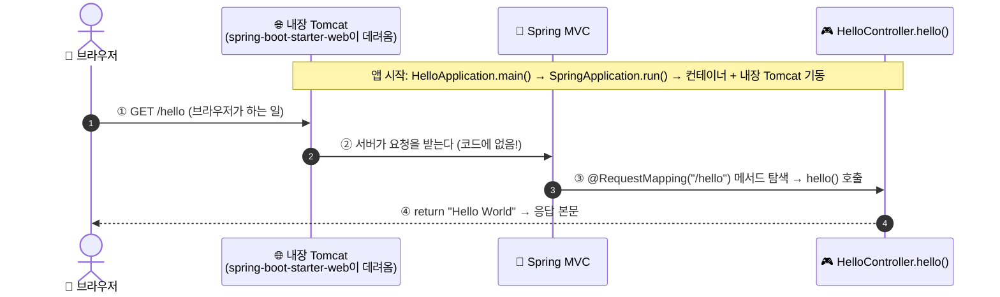
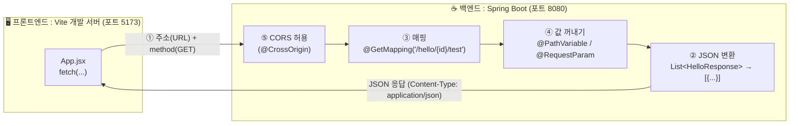
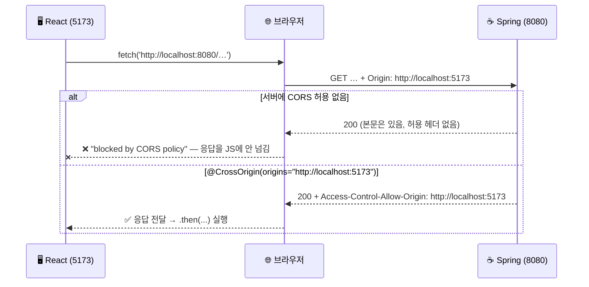
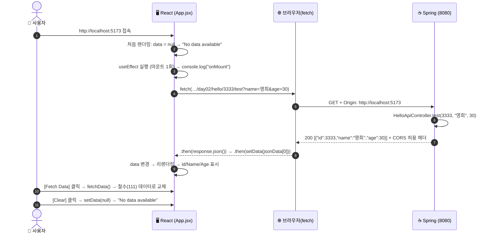

# [실습 & 아키텍처 가이드] 2. Spring Boot Hello API — pom.xml · 첫 Controller · 브라우저/API Tester · React 연동 누적 실습 가이드

이 문서는 강의 실습 자료(**`08_02_01_Maven과_pom.xml` ~ `08_02_08_코드리뷰`**, 총 8교시)를 처음 접하는 학습자가 **`pom.xml`(=`build.gradle.kts`) 읽는 법, 가장 작은 실행 가능 애플리케이션(`main` + `@RestController` + 매핑), `200 / 404 / 연결 실패`의 구분, API Tester, 그리고 수업 시간에 진행한 React ↔ Spring 연동(`fetch`, `useEffect`, CORS)** 을 직접 코드로 만들고 실행하며 이해하고, 우리의 누적형 실습 프로젝트(`practice_Spring`)에 차곡차곡 쌓아 갈 수 있도록 작성된 **'2번' 실습 & 개념 가이드**입니다.

강의 자료는 "남이 만든 `chapter4_hello`(Maven) 소스를 **읽고 표를 채우고 사본을 고치는** 방식"이었지만, 이 가이드는 **같은 내용을 우리 리포지토리(Gradle)에 직접 타이핑하고 실행해 보는 방식**으로 재구성했습니다. 8교시 분량이 모두 빠짐없이 들어 있고, 교시별 대응은 [부록 A](#부록-a-강의-8교시--이-가이드-대응표)에 있습니다. 여기에 **수업 중 연결한 React 코드(`App.jsx`)의 어느 부분이 스프링과 만나는지, `fetch` 함수를 포함한 코드 한 줄 한 줄의 의미**를 [Step 9](#step-9-react-코드-한-줄-한-줄-해설-fetch-포함)에서 풀어 설명합니다.

구성 순서는 **[초보자 눈높이 개념 해설 + 연동 큰 그림] → [환경 준비 & 파일 배치도] → [단계별 소스코드 및 한 줄 해설] → [React 연동] → [통합 동작 검증 미션] → [자주 겪는 오류 & 선택 도전 과제 풀이]** 입니다.

> [!NOTE]
> **이 문서의 코드는 "작성 예정" 코드입니다.** 이 가이드를 쓰는 시점에는 소스 파일을 만들지 않았고, 아래 `[신규]` 표시가 붙은 파일은 **학습자가 직접 만들 파일**입니다. 단, 수업에서 React가 호출한 스프링 쪽 API 코드는 원문에 없었으므로, **React의 `fetch` URL·응답 모양(`jsonData[0]`의 `id/name/age`)에 맞춰 역으로 구성한 예시**입니다. (Step 8 참고)

---

## 📌 목차

1. [초반 개념 완벽 정복: 가장 작은 웹 애플리케이션과 React 연동의 큰 그림](#1-초반-개념-완벽-정복-가장-작은-웹-애플리케이션과-react-연동의-큰-그림)
   - 1-1. `pom.xml`은 "재료 주문서" — 다섯 구역과 Gradle 대응
   - 1-2. 프로젝트를 어떻게 만들든 같아야 하는 것 (생성 방식 비교)
   - 1-3. 실행 가능한 최소 구조: 세 요소(`main` · Controller · 매핑)
   - 1-4. `GET /hello`의 네 단계 — 우리가 쓴 코드는 몇 번?
   - 1-5. 결과 코드 읽는 법: `200` · `404` · `405` · `500` · 연결 실패
   - 1-6. ⭐ React와 스프링은 **어디서** 만나는가? (연동 지점 5곳)
2. [사전 준비: JDK · Gradle · Node.js · 포트 2개(8080, 5173)](#2-사전-준비-jdk--gradle--nodejs--포트-2개8080-5173)
3. [프로젝트 구조 및 누적 실습 규칙](#3-프로젝트-구조-및-누적-실습-규칙)
4. [Step 1: `pom.xml` 읽기와 프로젝트 생성 방식 비교 (1·2교시)](#step-1-pomxml-읽기와-프로젝트-생성-방식-비교-12교시)
5. [Step 2: 첫 Controller 작성 — `HelloController` (3·5교시)](#step-2-첫-controller-작성--hellocontroller-35교시)
6. [Step 3: 실행하고 네 단계 추적하기 (4교시)](#step-3-실행하고-네-단계-추적하기-4교시)
7. [Step 4: 경로·반환값 한 번에 하나씩 바꿔 보기 (5교시)](#step-4-경로반환값-한-번에-하나씩-바꿔-보기-5교시)
8. [Step 5: 설정 파일 한 줄로 포트 바꾸기 — 브라우저 테스트 (6교시)](#step-5-설정-파일-한-줄로-포트-바꾸기--브라우저-테스트-6교시)
9. [Step 6: API Tester(`curl`)로 status·header 보기 (7교시)](#step-6-api-testercurl로-statusheader-보기-7교시)
10. [Step 7: 코드리뷰 — 변형 3종 예측과 "입력이 있는 API" (8교시)](#step-7-코드리뷰--변형-3종-예측과-입력이-있는-api-8교시)
11. [Step 8: React가 호출할 스프링 API 만들기 (Path · Query · JSON · CORS)](#step-8-react가-호출할-스프링-api-만들기-path--query--json--cors)
12. [Step 9: React 코드 한 줄 한 줄 해설 (`fetch` 포함)](#step-9-react-코드-한-줄-한-줄-해설-fetch-포함)
13. [Step 10: 오늘의 핵심 미션 — 통합 동작 검증 & 자동 테스트](#step-10-오늘의-핵심-미션--통합-동작-검증--자동-테스트)
14. [강사의 팁 — 자주 겪는 오류 10선 & 이해도 확인 Q&A (Q1~Q6)](#14-강사의-팁--자주-겪는-오류-10선--이해도-확인-qa-q1q6)
15. [🚀 선택 도전 과제 3종 구현 가이드](#-선택-도전-과제-3종-구현-가이드)
16. [🗺️ [미리보기] 3일차부터 이어 붙이는 법](#-미리보기-3일차부터-이어-붙이는-법)
- [부록 A. 강의 8교시 ↔ 이 가이드 대응표](#부록-a-강의-8교시--이-가이드-대응표)

---

## 1. 초반 개념 완벽 정복: 가장 작은 웹 애플리케이션과 React 연동의 큰 그림

1일차에는 `IoC/DI`처럼 추상적인 개념이 중심이었다면, 2일차는 **"브라우저(또는 React)가 보낸 요청 한 건이 내 코드의 어느 줄에 도착해서 어떤 응답이 되어 돌아가는가"** 를 가장 작은 예제로 끝까지 따라가는 날입니다. 그리고 마지막에 그 요청을 **브라우저 주소창이 아니라 React 코드가** 보내도록 바꿉니다.

---

### 💡 1-1. `pom.xml`은 "재료 주문서" — 다섯 구역과 Gradle 대응

강의의 `chapter4_hello/pom.xml`은 **위에서 아래로 다섯 구역**으로 읽습니다. (Maven은 XML, 우리 리포지토리는 Gradle Kotlin DSL이지만 **구역의 역할은 같습니다.**)

| # | 구역 | `chapter4_hello/pom.xml`의 실제 값 | 이 구역이 결정하는 것 | 우리 `build.gradle.kts` 대응 |
| :-: | :--- | :--- | :--- | :--- |
| ① | `<parent>` | `spring-boot-starter-parent` / `3.3.5` | **버전을 대신 정해 주는 곳** (버전을 안 적은 의존성의 버전을 누가 정하는가) | `id("org.springframework.boot") version "4.1.1"` + `id("io.spring.dependency-management")` |
| ② | 프로젝트 정체성 | `com.springboot` / `hello` / `0.0.1-SNAPSHOT` | **이 프로젝트가 누구인가** | `group`, `version`, `description`, `settings.gradle.kts`의 `rootProject.name` |
| ③ | `<properties>` | `java.version` = `17` | **몇 버전으로 컴파일할지** | `java { toolchain { languageVersion = JavaLanguageVersion.of(21) } }` |
| ④ | `<dependencies>` | 블록 **4개** | **무엇을 가져올지** (재료) | `dependencies { ... }` |
| ⑤ | `<build>` | `spring-boot-maven-plugin` | **어떻게 실행 가능한 형태로 묶을지** | `org.springframework.boot` 플러그인(`bootRun`, `bootJar`) |

`<dependencies>` 4개의 정체입니다.

| # | artifactId | 붙은 꼬리표 | 의미 | 우리 Gradle 대응 |
| :-: | :--- | :--- | :--- | :--- |
| 1 | `spring-boot-starter-web` | (없음) | ⭐ **웹 앱 필수 재료**: 내장 Tomcat + Spring MVC + JSON 변환 | `implementation(...starter-webmvc)` |
| 2 | `spring-boot-configuration-processor` | `<optional>true</optional>` | 설정 파일 자동완성용 도구 | (우리는 미사용) |
| 3 | `lombok` | `<optional>true</optional>` | `getter` 등 보일러플레이트 자동 생성 | `compileOnly` + `annotationProcessor` |
| 4 | `spring-boot-starter-test` | `<scope>test</scope>` | 테스트 도구 묶음 — **실행에는 안 들어감** | `testImplementation(...webmvc-test)` |

#### 🔤 `artifactId`는 8번 나오지만 뜻은 다섯 가지

`grep -c "artifactId" pom.xml` → **8** (줄 수). 같은 태그가 구역마다 다른 뜻으로 쓰입니다.

| 뜻 | 개수 | 값 |
| :--- | :-: | :--- |
| ① parent (상속받는 부모) | 1 | `spring-boot-starter-parent` |
| ② 프로젝트 자신 | 1 | `hello` ← **"이 프로젝트 자신"을 가리키는 것은 이것 하나뿐** |
| ③ 의존성(재료) | 4 | `starter-web`, `configuration-processor`, `lombok`, `starter-test` |
| ④ 플러그인 | 1 | `spring-boot-maven-plugin` |
| ⑤ 플러그인의 **제외 대상** | 1 | `lombok` (실행 jar에서 **빼라**는 뜻) |

> [!TIP]
> **왜 lombok을 jar에서 빼나?** Lombok은 **컴파일할 때만** 코드를 만들어 주는 도구라 실행할 때는 필요 없습니다. `<optional>true</optional>`("이 프로젝트에서는 쓰지만, 이 프로젝트를 가져다 쓰는 쪽에는 딸려 보내지 않는다")와 같은 맥락입니다. Gradle의 `compileOnly`가 정확히 같은 의미입니다.

---

### 💡 1-2. 프로젝트를 어떻게 만들든 같아야 하는 것 (생성 방식 비교)

프로젝트를 만드는 길은 여러 가지입니다.

| 생성 경로 | 설명 | 우리 리포지토리 |
| :--- | :--- | :---: |
| **Spring Initializr** (웹사이트 start.spring.io) | 옵션 선택 → zip 다운로드 | |
| **IDE wizard** (IntelliJ 새 프로젝트 → Spring Boot) | 내부적으로 Initializr를 호출 | ✅ (이 방식으로 생성) |
| **남이 준 소스를 열기** | 강의 `chapter4_hello`처럼 | |

> **결과물이 같은지 어떻게 확인할까요? 답은 빌드 파일(`pom.xml` / `build.gradle.kts`)입니다.** 생성 경로가 달라도 아래 **네 값이 같으면 같은 토대** 위에 있는 프로젝트입니다.

| 같아야 하는 값 | 어제 `chapter1` | 오늘 `chapter4_hello` | 같은가 |
| :--- | :--- | :--- | :---: |
| `<parent>` artifactId | `spring-boot-starter-parent` | `spring-boot-starter-parent` | ✅ |
| `<parent>` version | Boot 버전 | `3.3.5` | ✅ (같은 Boot 계열) |
| 자바 버전 | 17 | 17 | ✅ |
| `spring-boot-starter-web` 유무 | 있음 | 있음 | ✅ |

- **토대가 보장하는 것 한 문장**: "버전을 안 적은 의존성의 버전을 누가 정해 주는가(parent)가 같으므로, 두 프로젝트 모두 `starter-web`에 `<version>`을 쓰지 않고도 빌드가 성립한다."
- **달라도 되는 값**: `groupId` · `artifactId`(프로젝트 이름) · `<name>`/`<description>` — 프로젝트 정체성은 당연히 다릅니다. (`diff chapter1/pom.xml chapter4_hello/pom.xml` 결과가 이 줄들 + `optional` 의존성 2개로 나뉩니다.)

---

### 💡 1-3. 실행 가능한 최소 구조: 세 요소(`main` · Controller · 매핑)

`chapter4_hello`의 자바 파일은 **테스트 포함 3개**이고, 앱이 뜨는 데는 **2개**(+ 빌드 파일)면 충분합니다.

```text
chapter4_hello/
├─ pom.xml
└─ src/
   ├─ main/
   │  ├─ java/com/springboot/hello/HelloApplication.java            ← ① 출발점(main)
   │  ├─ java/com/springboot/hello/controller/HelloController.java  ← ② 요청을 받는 곳
   │  └─ resources/application.properties                           ← 설정(1바이트, 사실상 빈 파일)
   └─ test/java/com/springboot/hello/Chapter4HelloApplicationTests.java  ← 도식에서 빠진 파일(테스트)
```

| 요소 | 실제 코드 | 정하는 것 |
| :--- | :--- | :--- |
| ① 클래스 애너테이션 | `@RestController` | "이 클래스는 HTTP 요청을 받고 **반환값을 응답 본문 그대로** 내보낸다" (화면 파일 이름으로 해석하지 않음) |
| ② URL 매핑 | `@RequestMapping("/hello")` | "`/hello` 요청은 이 메서드가 받는다" |
| ③ 반환 리터럴 | `return "Hello World";` | 브라우저에 보이는 글자 |

> 💡 도식에서 `src/test`가 빠진 이유: 슬라이드 제목이 "실행 가능한 **최소** 구조"이기 때문입니다. 앱이 뜨는 데 꼭 필요한 것만 그렸습니다.

#### 🔍 "비어 있는 파일"과 "없는 파일"은 다릅니다

| 상황 | 앱이 뜨는가 | 의미 |
| :--- | :---: | :--- |
| 설정 파일이 **없다** | ✅ 뜸 | 전부 프레임워크 기본값 |
| 설정 파일이 **있는데 비어 있다** (강의 프로젝트: 1바이트 = 줄바꿈 하나) | ✅ 뜸 | 지정한 값이 없으니 역시 기본값 |
| 설정 파일에 값이 **들어 있다** | ✅ 뜸 | 그 값이 기본값을 덮어씀 |

비어 있는데도 남겨 두는 이유는 **6교시에 한 줄을 넣을 때 "파일부터 만들어야 하나?"를 고민하지 않기 위해서**입니다.

#### 🔍 본문이 빈 테스트(`contextLoads`)는 무엇을 검사하나?

```java
@SpringBootTest
class Chapter4HelloApplicationTests {
    @Test
    void contextLoads() { }   // 본문 0줄
}
```
검사하는 것은 메서드 본문이 아니라 **`@SpringBootTest`가 애플리케이션을 한 번 띄우는 것 자체**입니다. Bean 누락·순환 참조·설정 오류로 컨테이너가 뜨다 터지면 이 빈 메서드도 실패합니다.

---

### 💡 1-4. `GET /hello`의 네 단계 — 우리가 쓴 코드는 몇 번?



| # | 단계 | 근거 위치 |
| :-: | :--- | :--- |
| 1 | 브라우저가 `/hello`로 GET을 보낸다 | **코드에 없음** (브라우저가 하는 일) |
| 2 | 서버가 요청을 받는다 | **코드에 없음** — `pom.xml`의 `spring-boot-starter-web`이 내장 Tomcat을 데려옴 |
| 3 | 요청 경로와 맞는 메서드를 찾는다 | `HelloController.java` 10줄 `@RequestMapping("/hello")` |
| 4 | 반환값이 응답 본문이 된다 | `HelloController.java` 12줄 `return "Hello World";` |

> **우리가 쓴 코드는 네 단계 중 3번과 4번뿐입니다.** 서버를 설치하거나 설정한 코드가 한 줄도 없는데 서버가 동작한다는 사실이 "스프링 부트가 대신 해주는 일"입니다.

#### `SpringApplication.run(HelloApplication.class, args)`의 두 인자

| 인자 | 값 | 어디서 왔는가 |
| :-: | :--- | :--- |
| 첫 번째 | `HelloApplication.class` | **클래스 리터럴** — "이 클래스의 **패키지가 컴포넌트 탐색의 출발점**" |
| 두 번째 | `args` | **`main`의 파라미터** — `--server.port=9090` 같은 명령행 옵션을 스프링이 설정으로 읽음 |

#### 컨트롤러가 "발견되는" 이유 (패키지 규칙)

```text
com.springboot.hello                  ← HelloApplication  (@SpringBootApplication) = 탐색 출발점
com.springboot.hello.controller       ← HelloController   ✅ 하위 패키지 → 발견됨
com.example.other                     ← (만약 여기에 있다면) ❌ 출발점의 하위가 아님 → 발견 못 함
```
- 판별법: 패키지를 점(`.`)으로 끊어 **앞에서부터** 비교해, 한쪽이 다른 쪽으로 **시작**하면 그쪽이 상위입니다.
- 컨트롤러가 범위 밖이면 서버는 **정상적으로 떠 있지만** `/hello`를 아는 메서드가 없어서 **`404`** 가 됩니다. (코드가 틀린 게 아닙니다!)

---

### 💡 1-5. 결과 코드 읽는 법: `200` · `404` · `405` · `500` · 연결 실패

| 관찰 | 서버가 떠 있는가 | 그 경로(+method)의 매핑이 있는가 | 첫 확인 대상 |
| :--- | :---: | :---: | :--- |
| **200** + 응답 본문 | ✅ | ✅ | (정상 상태를 정확히 적어 두기) |
| **404** | ✅ | ❌ (그 **경로**를 아는 메서드가 없음) | 컨트롤러 파일의 매핑 문자열(오타·접두어), 패키지 위치 |
| **405** | ✅ | △ (경로는 있는데 **그 method는 안 받음**) | 매핑 애너테이션의 method (`@GetMapping`인데 POST를 보냈나?) |
| **500** | ✅ | ✅ (메서드까지 갔는데 **실행 중 예외**) | 서버 콘솔의 스택 트레이스 |
| **연결 실패** (connection refused) | ❌ | 해당 없음 | **파일이 아님** → 앱이 실제로 떠 있는가 + 내가 친 **포트 번호**가 맞는가 |

> 세 관찰(200/404/연결 실패)은 **서로 다른 단계**의 문제입니다. 연결 실패 = "서버까지 못 감", 404 = "서버엔 갔는데 그 주소를 모름", 500 = "주소까지 알아서 실행했는데 터짐".
> 오늘의 `hello()`에는 문자열을 돌려주는 문장 하나뿐이라 실패할 여지가 없어서 **`500`을 보기 어렵습니다.**

---

### 💡 1-6. ⭐ React와 스프링은 **어디서** 만나는가? (연동 지점 5곳)

수업에서 React(`App.jsx`)의 `fetch('http://localhost:8080/hello/3333/test?name=영희&age=30')`로 스프링을 연결했습니다. **"연동"이라고 부르는 것은 별도의 마법이 아니라, 아래 5곳이 서로 맞물리는 것**입니다.



| # | 연동 지점 | 프론트(React) 쪽 | 백엔드(Spring) 쪽 | 어긋나면? |
| :-: | :--- | :--- | :--- | :--- |
| ① | **주소 + method** | `fetch('http://localhost:8080/hello/…')` (기본 GET) | `@GetMapping("/…/hello/{id}/test")` 의 경로·method | `404` / `405` / 연결 실패 |
| ② | **데이터 형식(JSON)** | `response.json()` 로 해석, `jsonData[0]` 로 **배열의 첫 원소** 사용 | 메서드가 `List<HelloResponse>`(**배열**)를 반환 → 스프링이 JSON 배열로 변환 | `Unexpected token`, `undefined` 등 |
| ③ | **경로 변수** | URL의 `/3333/` 부분 | `@PathVariable("id")` | `400`/`404` |
| ④ | **쿼리 스트링** | `?name=영희&age=30` | `@RequestParam name`, `age` | `400 Bad Request` (필수 파라미터 누락) |
| ⑤ | ⭐ **CORS 허용** | (브라우저가 자동으로 `Origin: http://localhost:5173` 헤더를 붙임) | `@CrossOrigin(origins = "http://localhost:5173")` | **브라우저 콘솔에 `blocked by CORS policy`** (서버 로그엔 요청이 찍혀도 React는 응답을 못 읽음) |

> [!IMPORTANT]
> **React ↔ Spring 연동의 본질 한 문장**:
> React는 **다른 포트(5173)의 별개 서버**이고, `fetch`는 브라우저가 **HTTP 요청을 대신 보내 주는 함수**입니다. 스프링은 평소처럼 `@RestController` 로 **JSON을 돌려주기만** 하면 되고(화면은 모름), **"다른 출처(5173)에서 온 요청을 허용한다"(CORS)** 는 선언 한 번만 추가하면 연동이 완성됩니다.

---

## 2. 사전 준비: JDK · Gradle · Node.js · 포트 2개(8080, 5173)

1일차 환경(JDK 21, Gradle Wrapper, 8080 포트)이 그대로 필요하고, **React 연동을 위해 Node.js와 포트 5173**이 추가됩니다.

| # | 확인 항목 | 확인 방법 | 우리 환경의 기준 |
| :-: | :--- | :--- | :--- |
| ① | **JDK 21** | `java -version` | 1일차와 동일 |
| ② | **Gradle Wrapper** | `.\gradlew.bat --version` | 강의의 Maven Wrapper(`mvnw`)와 같은 역할 |
| ③ | **인터넷** | 첫 빌드/`npm install` | Gradle 배포본·의존성·npm 패키지 다운로드 필요 |
| ④ | **8080 포트 비어 있음 (스프링)** | `netstat -ano \| findstr :8080` | 이미 쓰는 프로그램이 있으면 앱이 못 뜸 |
| ⑤ | ⭐ **Node.js (LTS)** | `node -v` / `npm -v` | React(Vite) 실행용. 없으면 [nodejs.org](https://nodejs.org) 에서 LTS 설치 |
| ⑥ | ⭐ **5173 포트 비어 있음 (Vite)** | `netstat -ano \| findstr :5173` | Vite 개발 서버 기본 포트 |

> [!NOTE]
> **강의(Maven)와 우리(Gradle)의 명령 대응**: `./mvnw spring-boot:run` ↔ `.\gradlew.bat bootRun`, `./mvnw test` ↔ `.\gradlew.bat test`. 강의의 "`mvnw`에 실행 권한(`x`)이 없어 `Permission denied`"는 macOS/Linux 한정 문제(`sh mvnw …`, `chmod +x mvnw`, 또는 Windows용 `mvnw.cmd`)이며 우리 Windows 환경에선 해당 없습니다.
> 강의 `distributionUrl`(=`.mvn/wrapper/maven-wrapper.properties`)이 `https://repo.maven.apache.org/...` **원격 주소**이므로 첫 빌드엔 인터넷이 필요합니다. Gradle도 `gradle/wrapper/gradle-wrapper.properties`의 `distributionUrl`이 원격이라 같은 이유로 인터넷이 필요합니다.

---

## 3. 프로젝트 구조 및 누적 실습 규칙

1일차의 **누적 실습 4대 규칙**을 그대로 따릅니다. (요약: ① `dayXX_주제` 패키지, ② 계층 폴더 분리, ③ URL `/dayXX/...` 접두어, ④ 테스트도 같은 구조)

### 🔀 강의 방식과 달라지는 점 (중요!)

| 강의 | 우리 리포지토리 | 이유 |
| :--- | :--- | :--- |
| `chapter4_hello`를 `my_hello`로 **폴더 복사**해서 사본에서만 수정 (git이 없어서) | **복사하지 않고** `git switch -c day02-experiment` 같은 **브랜치/`git restore`** 로 원복 | 우리는 Git이 있어 훨씬 안전합니다 |
| 패키지 `com.springboot.hello` | `org.example.practice_spring.day02_hello` | 1일차 규칙 ① |
| 경로 `/hello` | `/day02/hello` | 규칙 ③ (URL 겹침 방지) |
| `main` 클래스 `HelloApplication` 새로 작성 | **기존 `PracticeSpringApplication` 재사용** (새로 만들지 않음) | main 클래스는 하나만 둔다 |

> [!WARNING]
> **`/hello` vs `/day02/hello`**: 수업의 React 코드는 `http://localhost:8080/hello/3333/test?...` 로 호출했습니다. 우리 누적 규칙을 지키려면 스프링 쪽 경로가 `/day02/hello/{id}/test` 가 되므로 **React의 `fetch` URL에도 `/day02` 를 붙여야** 합니다. (Step 9에 표시)

### 📂 이번 실습 파일 배치도

```text
practice_Spring/
 ├── build.gradle.kts                                   (기존 유지) 수정하지 않음
 ├── docs/guide/
 │    ├── 1.SPRING_DAY01_IOC_DI_AND_BOOT_BASICS_GUIDE.md          (기존 유지)
 │    └── 2.SPRING_DAY02_HELLO_API_MAVEN_AND_REACT_INTEGRATION_GUIDE.md   [신규] 본 가이드북
 ├── frontend/                                           [신규, Step 9] React(Vite) 프로젝트 — Gradle 빌드와 무관한 별도 폴더
 │    └── src/App.jsx                                    [수정] 수업 코드 (Vite 템플릿 파일 교체)
 └── src/
      ├── main/
      │    ├── java/org/example/practice_spring/
      │    │    ├── PracticeSpringApplication.java            (기존 유지) ★ main 클래스
      │    │    ├── day01_di/ ...                             (기존 유지) 1일차
      │    │    └── day02_hello/                              [신규 생성] 08_02 (2일차) 실습 전용 패키지
      │    │         ├── controller/
      │    │         │    ├── HelloController.java            [신규] 3·4·5·6·7교시  GET /day02/hello
      │    │         │    └── HelloApiController.java         [신규] React 연동      GET /day02/hello/{id}/test
      │    │         └── dto/
      │    │              └── HelloResponse.java              [신규] JSON 응답 모양 (id, name, age)
      │    └── resources/
      │         └── application.properties                    [Step 5에서 임시 수정 후 복구]
      └── test/java/org/example/practice_spring/day02_hello/
           └── Day02HelloTest.java                            [신규] 2일차 자동 검증
```

> [!CAUTION]
> **Bean 이름 충돌**: 1일차 경고대로 다른 패키지에 같은 클래스 이름이 있으면 `ConflictingBeanDefinitionException`이 납니다. 위 `HelloController`, `HelloApiController`, `HelloResponse`는 현재 리포지토리에 없는 이름이라 안전하지만, 이후 날짜에서 `HelloController`를 또 만들지 마세요.

---

## Step 1: `pom.xml` 읽기와 프로젝트 생성 방식 비교 (1·2교시)

### 📌 이 단계는 파일을 만들지 않고 **읽는** 단계입니다

**1교시 — `pom.xml` 다섯 구역 읽기** (강의 파일 `chapter4_hello/pom.xml` 과 우리 `build.gradle.kts` 를 나란히 놓고)

```powershell
# 강의 폴더에서 (Maven): <dependency> 블록 수 → 4, artifactId 줄 수 → 8
grep -c "<dependency>" pom.xml
grep -c "artifactId" pom.xml
grep -n "artifactId" pom.xml

# 우리 리포지토리 루트에서 (Gradle): 의존성 줄 확인
Select-String -Path build.gradle.kts -Pattern "implementation|compileOnly|testImplementation|annotationProcessor"
```
> Windows PowerShell에는 `grep`이 없습니다. 강의 폴더는 Git Bash에서, 또는 `Select-String -Path pom.xml -Pattern "artifactId"` 로 대체하세요. `(Select-String ... ).Count` 가 줄 수입니다.

**빌드 가능 여부 판정 (1교시 1-4)**

| 확인 항목 | 강의 값 | 우리 환경 |
| :--- | :--- | :--- |
| 요구 자바 버전 | `<java.version>17</java.version>` | toolchain **21** |
| 설치된 JDK가 요구보다 **낮은가?** | 낮으면 안 됨 (**높은 건 문제 없음** — `java.version`은 "이 버전으로 컴파일하라"는 목표값) | `java -version` ≥ 21 |
| 빌드 도구 직접 설치(`which mvn`) | 출력 없음 = 설치 안 됨 (정상) | `gradle` 직접 설치 불필요 — `gradlew.bat` 사용 |
| 래퍼 실행 권한 | macOS/Linux에서 `mvnw`에 `x` 없음 → `sh mvnw`, `chmod +x mvnw`, 또는 Windows는 `mvnw.cmd` | 해당 없음 |
| `distributionUrl` | 원격(`https://…`) → **첫 빌드에 인터넷 필요** | 동일 |
| 빌드 산출물 폴더 | `target/` (`.gitignore`에 있음, 저장소에 없는 게 정상) | `build/` |

> **빌드 성공은 합격 조건이 아닙니다.** 실패하면 `.gitignore`와 `ls`로 "빌드 산출물 폴더(`target/`)가 저장소에 없는 것이 정상"임을 확인하는 것으로 1교시는 완료입니다.

**2교시 — 두 프로젝트 비교** (`diff chapter1/pom.xml chapter4_hello/pom.xml`)

diff에 나오는 줄을 세 부류로 나눕니다. (**③번이 비어 있어야 정상**)

| 부류 | 해당하는 줄 |
| :--- | :--- |
| ① 정체성 | `<groupId>`, `<artifactId>`, `<name>`, `<description>` |
| ② 의존성·빌드 설정 | `configuration-processor`, `lombok`, `<excludes>` 블록 |
| ③ 어느 쪽도 아님 | (없음) |

**2-4. `spring-boot-starter-web`을 지우면 무엇이 깨지나 (종이 위에서만 — 실제로 지우지 마세요)**

`grep -rn "^import org.springframework" src/main/java` → **4줄** (`HelloApplication` 2줄 + `HelloController` 2줄)

| import 문 | 어느 파일 | 없어지면 못 쓰는 것 |
| :--- | :--- | :--- |
| `org.springframework.boot.SpringApplication` | HelloApplication | `SpringApplication.run` (컨테이너 기동) |
| `org.springframework.boot.autoconfigure.SpringBootApplication` | HelloApplication | `@SpringBootApplication` |
| `org.springframework.web.bind.annotation.RequestMapping` | HelloController | `@RequestMapping` |
| `org.springframework.web.bind.annotation.RestController` | HelloController | `@RestController` |

- `org.springframework.web…`로 시작하는 것은 **2개**이고, 이것을 가져다준 의존성은 **`spring-boot-starter-web`** 입니다. 이 줄을 지우면 위 2개가 컴파일되지 않습니다.
- 코드엔 안 나오지만 함께 오는 것: **웹 요청을 받아 주는 서버(내장 Tomcat)**. `application.properties`는 1바이트(사실상 빈 파일)라서 서버를 설정한 흔적이 없습니다.

### 🔍 코드 읽기 포인트
1. **starter는 "묶음"** 입니다. 한 줄을 지우면 어느 `import`가 깨지는지로 말하면 "여러 기능을 끌고 온다"를 설명할 수 있습니다.
2. **Lombok을 왜 넣었나?** 오늘은 안 씁니다(컨트롤러 `import`에 Lombok 없음). 뒤 일차에서 DTO·엔티티에 씁니다. "지금 필요 없다"가 정답입니다.
3. 직접 쓰지 않는데 `pom.xml`에 있는 이유: 이후 일차에서 쓸 재료를 **미리 준비**해 둔 것 (`optional`=배포물엔 딸려 보내지 않음).

---

## Step 2: 첫 Controller 작성 — `HelloController` (3·5교시)

### 📌 파일 역할 (강의 3·4·5·6·7교시 대응)

가장 작은 컨트롤러 하나를 만듭니다. 강의에서는 이미 있는 `HelloController`를 **읽기만** 했지만, 우리는 **직접 타이핑**합니다. (`main` 클래스는 이미 있으므로 새로 만들지 않습니다.)

- **위치**: `src/main/java/org/example/practice_spring/day02_hello/controller/` (`[신규 생성]`)

#### 2-1. `HelloController.java` (강의 예제 4.1)
```java
package org.example.practice_spring.day02_hello.controller;

import org.springframework.web.bind.annotation.RequestMapping;
import org.springframework.web.bind.annotation.RestController;

/**
 * [역할] 예제 4.1 - 가장 작은 컨트롤러 (강의 HelloController 에 대응).
 * - @RestController : 이 클래스는 HTTP 요청을 받고, 반환값을 '응답 본문 그대로' 내보낸다.
 * - @RequestMapping("/day02/hello") : 이 경로의 요청은 hello() 가 받는다. (method 를 안 적었으므로 GET/POST 등 전부 받음)
 * - 강의의 "/hello" 에 /day02 접두어를 붙인 것 (누적 규칙 ③).
 */
@RestController
public class HelloController {

    @RequestMapping("/day02/hello")
    public String hello() {
        return "Hello World";   // 이 리터럴을 바꾸는 분기도, 외부 입력도 없다 -> 실행 안 해도 응답 본문이 확정된다
    }

}
```

### 🔍 코드 읽기 포인트
1. **세 요소**: ① `@RestController`(응답 본문 그대로) ② `@RequestMapping("/day02/hello")`(URL 연결) ③ `return "Hello World"`(화면 글자).
2. **메서드 이름 `hello`는 URL과 아무 상관이 없습니다.** URL과 메서드를 잇는 것은 메서드 이름이 아니라 **애너테이션의 값**입니다. (이름이 같아 보이는 건 우연 — Step 4에서 `/welcome`으로 바꿔 보면 확실해집니다.)
3. **`@RestController`의 반환 문자열을 "화면 파일 이름"으로 해석하지 않습니다.** 브라우저에는 `Hello World` 글자 그대로 보입니다. (`@Controller`였다면 `Hello World.html` 같은 뷰를 찾으려 했을 것)
4. **분기·파라미터가 없으므로** `if`도 0개, 메서드 괄호 안도 비어 있습니다. → 실행하지 않고도 **본문이 `Hello World`로 확정**됩니다.

---

## Step 3: 실행하고 네 단계 추적하기 (4교시)

### 📌 실행 방법
```powershell
.\gradlew.bat bootRun          # 또는 IntelliJ에서 PracticeSpringApplication ▶
```
정상이라면 로그 끝에 이런 줄이 보입니다.
```text
Tomcat started on port 8080 (http) with context path '/'
Started PracticeSpringApplication in 1.x seconds
```
> 4교시 규칙: **로그의 포트 번호는 예측하지 말고 "관측한 값"을 적습니다.** 다른 프로그램이 8080을 쓰거나 IDE 설정이 다르면 값이 달라질 수 있고, 그때는 관측값이 정답입니다.

### 📌 호출
```powershell
curl http://127.0.0.1:8080/day02/hello      # → Hello World
```

### 🔍 `run`에 넘기는 인자와 네 단계 (1-4 표와 대조)
- 우리의 `main`: `SpringApplication.run(PracticeSpringApplication.class, args);` → 첫 인자 `PracticeSpringApplication.class`(탐색 출발점: `org.example.practice_spring`), 둘째 인자 `args`(명령행 옵션).
- `HelloController`가 `...practice_spring.day02_hello.controller`에 있으므로 **출발점의 하위** → 발견됨.

### 🌐 브라우저 vs API Tester

| 도구 | 빠르게 보여 주는 것 | 추가로 관찰 가능 | 불편한 점 |
| :--- | :--- | :--- | :--- |
| 브라우저 | 주소만 치면 본문 | (개발자도구 Network 탭을 열면 가능) | **주소창으로는 GET만** 보낼 수 있음 |
| API Tester (`curl`/Postman/IDE HTTP Client) | method·헤더·본문을 마음대로 구성 | **status, Content-Type 등 응답 헤더, 소요 시간** | 설치·사용법 학습 |

- 브라우저 주소창만으로는 보내기 어려운 method: **POST, PUT(, DELETE)**
- 브라우저 화면만으로는 확인하기 어려운 것: **status 코드, 응답 헤더(`Content-Type`)**
- 응답 본문이 같아도 두 도구의 관찰 결과가 다를 수 있는 이유: 브라우저는 **본문을 "그려서" 보여 주고**, API Tester는 **응답 전체(status + 헤더 + 본문)를 있는 그대로** 보여 주기 때문입니다.

---

## Step 4: 경로·반환값 한 번에 하나씩 바꿔 보기 (5교시)

### 📌 5교시의 "사본" = 우리의 "Git 브랜치"
강의는 `cp -r chapter4_hello my_hello`로 사본을 만들어 거기서만 수정했습니다(원본이 망가지면 복구 수단이 없어서). **우리는 Git이 있으므로** 아래처럼 합니다.

```powershell
git status --short                       # 깨끗한 상태 확인 (또는 먼저 커밋)
git switch -c day02-experiment           # 실험용 브랜치 (원본은 main에 그대로)
```

### 🧪 실험 A — 매핑 경로만 변경 (`@RequestMapping("/day02/welcome")`)

고치기 **전에** 예측하세요. (경로는 `/day02/welcome`, 반환은 아직 `Hello World`)

| 요청 URL | 예측 status | 예측 응답 본문 |
| :--- | :---: | :--- |
| `GET /day02/hello` | **404** | (Spring 에러 JSON) — 서버는 떠 있는데 그 주소를 아는 메서드가 없음 |
| `GET /day02/welcome` | **200** | `Hello World` |

변경으로 **바뀌는 것 / 안 바뀌는 것**

| 항목 | 바뀌나 |
| :--- | :---: |
| 브라우저에 쳐야 하는 URL | ✅ 바뀐다 |
| 메서드 이름 (`hello`) | ❌ 그대로 (URL과 무관) |
| 응답 본문 | ❌ 그대로 |
| 클래스 애너테이션 | ❌ 그대로 |

### 🧪 실험 B — 반환 문자열만 변경 (`return "Hello Spring Boot";`)

| 변경 | 바꾸는 것 | **못** 바꾸는 것 |
| :--- | :--- | :--- |
| 경로 변경 | 접속 URL | 응답 본문 |
| 반환값 변경 | 응답 본문 | 접속 URL |

재시작 후 관측값은 `/day02/hello` → 404, `/day02/welcome` → 200 `Hello Spring Boot` 입니다. `/day02/hello` 쪽 근거는 "그 경로를 받는 애너테이션이 프로젝트 어디에도 없다" (`Select-String -Path src\main -Pattern '"/day02/hello"' -Recurse` 결과 없음)입니다.

### ✅ 원복 확인 (5-5 "원본 무손상 확인"의 Git 버전)
```powershell
git restore src/main/java/org/example/practice_spring/day02_hello/controller/HelloController.java
git diff --stat              # 출력이 없어야 함
git switch -                 # 원래 브랜치로
```
> 단, `HelloController.java`가 **아직 한 번도 커밋되지 않았다면 `git restore`가 되돌릴 기준이 없습니다.** 실험 전에 먼저 `git add . && git commit` 해 두세요. 강의가 "수정 전에 원본 내용을 옮겨 적어 두라"고 한 것의 Git 버전입니다. **오늘의 교훈: 고치기 전에 되돌릴 기록을 남겨라.**

---

## Step 5: 설정 파일 한 줄로 포트 바꾸기 — 브라우저 테스트 (6교시)

### 📌 파일 역할
5교시는 **자바 코드**를 고쳤고, 이번에는 **코드 밖**(설정 파일 한 줄)으로 실행 조건을 바꿉니다.

- **위치**: `src/main/resources/application.properties` (`[임시 수정 후 반드시 복구]`)
- 현재: `spring.application.name=practice_spring`

### 🧪 절차
**① 기준선**
```powershell
(Select-String -Path src\main\resources\application.properties -Pattern "server.port").Count   # → 0
```
**② 한 줄 추가**: 새 포트 B는 8080이 아닌 값 (예: `8081`)
```properties
spring.application.name=practice_spring
server.port=8081
```
**③ 예측 후 재시작**: 기존 포트 A=8080, 새 포트 B=8081. (5교시에서 경로를 `/welcome`으로 바꿨다면 아래 `/day02/hello` 자리를 `/day02/welcome`으로 읽으세요. 원복했다면 그대로입니다.)

| 요청 URL | 연결 되는가 | 결과 |
| :--- | :---: | :--- |
| `A(8080) + /day02/hello` | ❌ | **연결 실패** (그 포트에선 아무도 안 듣고 있음) |
| `B(8081) + /day02/hello` | ✅ | **200** `Hello World` |
| `B(8081) + /nothing-here` | ✅ | **404** (서버는 떠 있고 그 경로 매핑이 없음) |

> 특히 **"A + 정상 경로"가 `연결 실패`이고 "B + 엉터리 경로"가 `404`** 라는 비교가 핵심입니다. 같은 "안 된다"처럼 보여도 하나는 **서버 문제(포트)**, 하나는 **매핑 문제(경로)** 입니다.

**④ 복구(필수)**: `server.port=8081` **줄 자체를 삭제**(주석 처리 `#server.port=8081` 은 문자열이 남아 건수가 계속 1로 잡힙니다).

**⑤ 복구 확인**
```powershell
git diff -- src/main/resources/application.properties        # 출력 없어야 함
(Select-String -Path src\main\resources\application.properties -Pattern "server.port").Count   # → 0
```

### 🔍 코드 읽기 포인트
1. **이번 교시에 자바 파일은 한 줄도 안 고쳤습니다.** `git diff --name-only` 에 `.java`가 없고 `application.properties`만 나옵니다. → "코드를 고치지 않고 실행 조건을 바꿨다".
2. 이 한 줄이 **못** 바꾸는 것: ① 컨트롤러 매핑 경로 ② 반환 문자열 ③ 어떤 클래스가 컨트롤러로 등록되는지. 매핑은 `HelloController.java`에, 포트는 `application.properties`에 적혀 있어 **파일이 다릅니다.**
3. **속성 이름이 틀리면(`serverport`, `server_port`) 스프링은 조용히 무시**합니다. 오류가 안 나므로 "고쳤는데 아무 일도 안 일어난" 상태가 됩니다.
4. 설정 파일은 **뜰 때 한 번** 읽힙니다 → 재시작 필수. 우선순위는 `명령행 인자(--server.port=9090) > application.properties`.

---

## Step 6: API Tester(`curl`)로 status·header 보기 (7교시)

### 📌 요청을 명시적으로 구성해 보내기

PowerShell에서는 `curl`이 `Invoke-WebRequest` 별칭이라 헤더가 보기 불편합니다. **`curl.exe`** 로 쓰세요. (또는 IntelliJ HTTP Client, Postman)

```powershell
curl.exe -i http://127.0.0.1:8080/day02/hello
```
```text
HTTP/1.1 200
Content-Type: text/plain;charset=UTF-8
Content-Length: 11
...
Hello World
```

| 요청 구성 요소 | 값 |
| :--- | :--- |
| method | `GET` |
| URL | `http://127.0.0.1:8080/day02/hello` |
| 요청 헤더 | 없음 |
| 요청 본문 | 없음 |

- 브라우저로는 보기 어려웠던 **status**, **`Content-Type`** 이 여기서 보입니다.
- **본문은 소스(`return` 리터럴)로 확정할 수 있지만 status와 `Content-Type`은 우리가 쓴 코드가 아니라 프레임워크가 정하는 값**입니다. 그래서 단정하지 말고 "실행해서 봐야 하는 값"으로 분류합니다.

### 🧪 `@RequestMapping` vs `@GetMapping` — POST를 보내면?

```powershell
curl.exe -i -X POST http://127.0.0.1:8080/day02/hello
```

| 애너테이션 | 받는 HTTP method | 현재 소스에 쓰였나 | 의도가 코드에 드러나나 | POST 요청 결과 |
| :--- | :--- | :---: | :---: | :---: |
| `@RequestMapping("/day02/hello")` | **전부** (method 미지정) | ✅ (지금) | ❌ (읽기 전용인지 모름) | **200** `Hello World` |
| `@GetMapping("/day02/hello")` | **GET만** | ❌ | ✅ ("읽기 요청") | **405 Method Not Allowed** |

### 🧪 실험 — method를 명시하도록 바꾸기 (실험 브랜치에서)
```java
import org.springframework.web.bind.annotation.GetMapping;      // import도 함께 바꿔야 한다!

@GetMapping("/day02/hello")
public String hello() { return "Hello World"; }
```
- **GET 요청의 결과는 바뀌지 않습니다.** (GET은 변경 전에도, 후에도 받음) 바뀌는 건 「받아들이는 method의 **범위**」와 「읽는 사람이 아는 것」입니다 → **동작이 아니라 표현이 달라지는 변경**.
- 애너테이션 이름만 바꾸고 `import`를 안 바꾸면 `cannot find symbol` 컴파일 오류가 납니다. 정상적인 오류입니다.
- 1일차에서 이미 `@GetMapping`을 썼으므로, **앞으로는 `@GetMapping` / `@PostMapping`처럼 method가 드러나는 쪽을 기본으로** 씁니다. (Step 8의 React 연동 API도 `@GetMapping`)

### 🧪 패키지를 벗어나면 컨트롤러가 사라진다 (종이 위에서만 — 파일을 옮기지 마세요)

| 항목 | 현재 | `...other` 패키지로 옮겼다고 가정 |
| :--- | :--- | :--- |
| 컨트롤러 `package` | `org.example.practice_spring.day02_hello.controller` | `com.example.other` |
| main 클래스(`org.example.practice_spring`)의 하위인가 | ✅ | ❌ |
| 컴포넌트 탐색에 걸리는가 | ✅ | ❌ |
| `/day02/hello` 결과 | 200 | **404** (서버는 떠 있고 그 경로를 아는 메서드가 없음) |

- 학습자가 흔히 하는 오해는 "코드가 틀렸나?"이지만, **코드는 멀쩡하고 '찾아 주는 범위' 밖에 있을 뿐**입니다.
- 옮긴 채 동작시키는 두 방향: ① 컨트롤러를 원래 자리로 되돌린다 ② 탐색 범위를 넓혀 준다(`@SpringBootApplication(scanBasePackages = …)` — 뒤 과정).

### 📋 `GET /hello`에 **직접 필요한 것 / 아닌 것** (7-5)

| 구성 요소 | 직접 필요한가 | 근거 |
| :--- | :---: | :--- |
| `HelloApplication.java` (우리는 `PracticeSpringApplication`) | ✅ | 어느 `import`에도 안 나오지만 **없으면 앱이 안 뜸** (실행 출발점) |
| `HelloController.java` | ✅ | 요청을 받는 곳 |
| `application.properties` (비어 있을 때) | ❌ | 없어도 앱이 뜸 (기본값) |
| `Chapter4HelloApplicationTests.java` | ❌ | 테스트는 실행 응답과 무관 |
| 의존성: web starter | ✅ | 컨트롤러의 `org.springframework.web…` import + 내장 서버 |
| 의존성: configuration processor | ❌ | `optional`, 컨트롤러 import에 없음 |
| 의존성: Lombok | ❌ | `optional`, 컨트롤러 import에 없음 |
| 의존성: test starter | ❌ | `<scope>test</scope>` → 실행에 안 들어감 |

- 판정 요령: **`import`에 등장하는가**는 **의존성(라이브러리)** 판정에만 쓰고, **자바 파일**은 "없으면 이 응답이 나오는가"로 판정합니다.
- "직접 필요"만 남겨도 앱은 여전히 `GET /hello`에 응답합니다 ✅. 나머지는 **뒤 일차(DTO, DB, 테스트)에서 쓸 재료를 미리 넣어 둔 것**입니다.

---

## Step 7: 코드리뷰 — 변형 3종 예측과 "입력이 있는 API" (8교시)

### 📌 8-1. 오늘의 흐름을 **실제 이름**으로 꿴다

"컨트롤러가 요청을 받아…" 같은 일반 설명 대신 **검색하면 걸리는 이름**으로 채웁니다.

| # | 칸 | 강의 `chapter4_hello`의 실제 이름 | 우리 `practice_Spring`의 실제 이름 | 몇 교시 |
| :-: | :--- | :--- | :--- | :-: |
| 1 | 빌드 재료 파일 | `pom.xml` | `build.gradle.kts` | 1 |
| 2 | 실행 시작 클래스·메서드 | `HelloApplication.main` | `PracticeSpringApplication.main` | 3·4 |
| 3 | 요청을 받아 주는 것 (코드에 없음) | `spring-boot-starter-web`(내장 Tomcat) | `spring-boot-starter-webmvc` | 2·4 |
| 4 | 브라우저가 보내는 요청 | `GET /hello` | `GET /day02/hello` | 4 |
| 5 | 도착하는 클래스·메서드 | `HelloController.hello()` | `HelloController.hello()` | 3·4 |
| 6 | 응답 본문 리터럴 | `"Hello World"` | `"Hello World"` | 3 |

**한 줄 요약**: `pom.xml` → `HelloApplication.main` → `spring-boot-starter-web`(내장 Tomcat) → `GET /hello` → `HelloController.hello()` → `"Hello World"`
**우리가 쓴 코드는 여섯 칸 중 2개(5번, 6번 — 사실상 컨트롤러 한 파일; 2번 main도 쓰지만 템플릿이 만들어 준 것)** 입니다. 3번에 "코드에 없음"이 이상해 보이면 [1-4](#-1-4-get-hello의-네-단계--우리가-쓴-코드는-몇-번)를 다시 보세요.

### 📌 8-2. 세 가지 변형을 **실행 없이** 구분 (원본 기준 각각 따로 적용한다고 가정)

| 변형 | 서버는 뜨는가 | `/hello`가 200인가 | 응답 본문 |
| :--- | :---: | :---: | :--- |
| ① 클래스의 `@RestController` **제거** | ✅ 뜸 | ❌ **404** | (Spring 기본 404 에러 응답) |
| ② 경로를 `/hi`로 변경 | ✅ 뜸 | ❌ **404** (`/hi`는 200) | (404 응답) |
| ③ 반환값을 `Hi`로 변경 | ✅ 뜸 | ✅ **200** | `Hi` |

- ① 근거: 클래스가 컴포넌트(컨트롤러)로 **등록되지 않으면 그 안의 매핑도 등록되지 않는다.** (패키지 이탈과 **같은 결과**)
- ② 근거: 매핑 값이 `/hi`가 되었으니 `/hello`를 받는 메서드가 없다. (실험 A에서 직접 해 본 변경)
- ③ 근거: URL 매핑은 그대로고 `return` 값만 바뀐다. (실험 B)
- **①과 ②는 결과(404)가 같아 보이지만 원인이 다릅니다**: ①은 *클래스 자체가 등록되지 않음*, ②는 *클래스는 등록됐는데 경로 값이 다름*.
- **③만 결과가 다른 이유**: ③만 "경로(URL)"가 아니라 "응답 본문"을 건드렸기 때문입니다.
- **한 문장**: *"애너테이션(등록/경로)을 건드리면 URL이 죽고, `return` 값을 건드리면 본문만 바뀐다."*

### 📌 8-3. 다음은 입력이 있는 API다 → **React 연동의 출발점**

```java
public String hello() { ... }     // 괄호 안이 비어 있음 = "이 API는 입력이 없다"의 코드상 증거
```

사용자 이름을 받아 `Hello, 홍길동`을 돌려주려면 **메서드 괄호 안(파라미터 자리)** 이 달라져야 합니다. 값이 실려 오는 곳은 세 가지입니다.

| 경로 | 값이 실려 오는 곳 | 요청 예시 | 스프링 파라미터 |
| :--- | :--- | :--- | :--- |
| GET — 경로의 일부로 | **주소 자체** | `GET /day02/hello/홍길동` | `@PathVariable String name` |
| GET — 주소 뒤 질의 문자열 | 주소의 `?` 뒤 | `GET /day02/hello?name=홍길동` | `@RequestParam String name` |
| POST — 요청 본문으로 | **주소가 아닌 body** | `POST /day02/hello` + `{"name":"홍길동"}` | `@RequestBody 요청DTO` |

- **POST로 JSON 본문을 보내려면 요청 헤더 `Content-Type: application/json`** 이 필요합니다. (7교시에서 *응답* 쪽으로 관측했던 그 헤더의 **요청판**)
- 브라우저 **주소창으로 보낼 수 있는 것**은 앞의 두 가지(GET)뿐입니다. 세 번째는 API Tester나 **React의 `fetch`** 로 보냅니다. → 이어지는 Step 8·9가 바로 이 내용입니다.
- **다음 일차 질문 예시**: "여러 건을 저장하고 조회하려면 데이터를 어디에 보관하나? (→ Repository, DB)"

### 📌 8-4. 원본(=main 브랜치)은 그대로인가 — 하루를 닫는 확인
```powershell
git switch main
git diff --stat                                                # 출력 없음 = 실험 흔적이 없음
(Select-String -Path src\main\resources\application.properties -Pattern "server.port").Count   # → 0
```
사본 변경 목록(경로 · 반환값 · 포트 · 매핑 애너테이션)을 정리하고, 한 문장으로 마무리합니다 — **"실험을 브랜치에서 했기에 `main`의 컨트롤러·설정 파일이 망가질 위험이 0이었다."**

---

## Step 8: React가 호출할 스프링 API 만들기 (Path · Query · JSON · CORS)

### 📌 React 연동은 "예시"입니다 — 실습 코드와 이렇게 연결합니다

> [!IMPORTANT]
> 수업의 React 코드(버튼 2개, `Clear`/`Fetch Data` 등)는 **연동이 되는 모습을 보여 주는 예시**일 뿐, 그런 화면을 꼭 만들어야 하는 것이 아닙니다. 이 가이드에서 **React가 꼭 해야 하는 일은 단 하나, 우리 실습의 스프링 API를 `fetch`로 호출해 응답을 화면에 보여 주는 것**입니다. 화면 구성(버튼, 스타일, 상태 개수)은 자유입니다.

React가 호출하는 대상은 새로 만드는 별개 API가 아니라, **이번 실습 흐름 위에 놓인 API**입니다.

| 단계 | 스프링 쪽 (실습) | React가 하는 일 | 응답 |
| :-: | :--- | :--- | :--- |
| **A. 최소 연동** | Step 2의 `HelloController` `GET /day02/hello` (그대로, `@CrossOrigin` 한 줄만 추가) | `fetch('…/day02/hello')` → `response.text()` | 글자 `Hello World` |
| **B. 입력이 있는 API** | Step 7의 8-3 (입력이 있는 API)을 실제로 만든 `HelloApiController` `GET /day02/hello/{id}/test?name&age` | 값을 URL에 실어 `fetch` → `response.json()` | JSON 배열 |

A는 1~7교시에서 만든 코드 **그대로**를 브라우저 주소창 대신 React가 호출하는 것이고, B는 8교시 "다음은 입력이 있는 API다"의 답입니다. 아래 Step 8은 B의 스프링 쪽, Step 9는 A→B 순서의 React 쪽입니다.

### 📌 (B) 파일 역할
수업의 React 예시가 호출하는 `GET /hello/{id}/test?name=…&age=…` 에 대응하는 **스프링 쪽**을 만듭니다. React가 `jsonData[0]` 으로 쓰고 `data.id / data.name / data.age` 를 읽으므로, 스프링은 **`{id, name, age}` 객체를 원소로 하는 배열**을 돌려줘야 합니다.

> [!NOTE]
> 수업에서 React가 연결한 스프링 쪽 소스는 가이드 원문에 포함되어 있지 않았습니다. 아래는 **React 코드와 정확히 맞물리도록 역으로 구성한 예시**이며, 실제 수업 코드와 클래스·메서드 이름이 달라도 **연동 지점 5곳(1-6)이 맞으면** 동일하게 동작합니다.

- **위치**: `src/main/java/org/example/practice_spring/day02_hello/` (`[신규 생성]`)

#### 8-1. JSON 응답 모양 — `dto/HelloResponse.java`
```java
package org.example.practice_spring.day02_hello.dto;

/**
 * [역할] React 에게 돌려줄 JSON 한 건의 모양 -> {"id":3333,"name":"영희","age":30}
 * - record 는 필드(id, name, age)에 대한 getter 를 자동으로 만들어 주고, 스프링(Jackson)이 이를 JSON 으로 변환한다.
 */
public record HelloResponse(Long id, String name, int age) {
}
```

#### 8-2. API 컨트롤러 — `controller/HelloApiController.java`
```java
package org.example.practice_spring.day02_hello.controller;

import java.util.List;
import org.example.practice_spring.day02_hello.dto.HelloResponse;
import org.springframework.web.bind.annotation.CrossOrigin;
import org.springframework.web.bind.annotation.GetMapping;
import org.springframework.web.bind.annotation.PathVariable;
import org.springframework.web.bind.annotation.RequestParam;
import org.springframework.web.bind.annotation.RestController;

/**
 * [역할] React(포트 5173)가 fetch 로 호출하는 JSON API.
 * - @CrossOrigin : "http://localhost:5173 에서 온 요청을 허용한다" (CORS). 이 줄이 없으면 브라우저가 응답을 막는다.
 * - GET /day02/hello/{id}/test?name=영희&age=30
 *      {id}            -> @PathVariable   (경로의 일부)
 *      name, age       -> @RequestParam   (? 뒤 질의 문자열)
 * - 반환 타입이 List 이므로 JSON '배열'이 된다 -> React 의 jsonData[0] 과 맞물린다.
 */
@RestController
@CrossOrigin(origins = "http://localhost:5173")
public class HelloApiController {

    @GetMapping("/day02/hello/{id}/test")
    public List<HelloResponse> test(@PathVariable("id") Long id,
                                    @RequestParam("name") String name,
                                    @RequestParam("age") int age) {
        return List.of(new HelloResponse(id, name, age));
    }

}
```

### 🧪 React 없이 먼저 스프링만 검증 (curl)
```powershell
curl.exe -i "http://127.0.0.1:8080/day02/hello/3333/test?name=%EC%98%81%ED%9D%AC&age=30"
```
```text
HTTP/1.1 200
Content-Type: application/json
...
[{"id":3333,"name":"영희","age":30}]
```
> 한글을 `curl`에 직접 쓰면 터미널 인코딩 때문에 깨질 수 있어 위처럼 **퍼센트 인코딩(`%EC%98%81%ED%9D%AC` = "영희")** 을 씁니다. 브라우저/`fetch`는 URL의 한글을 UTF-8로 **자동 인코딩**해 보냅니다.

### 🧪 CORS 확인 (브라우저 흉내)
```powershell
curl.exe -i -H "Origin: http://localhost:5173" "http://127.0.0.1:8080/day02/hello/3333/test?name=a&age=1"
```
응답 헤더에 **`Access-Control-Allow-Origin: http://localhost:5173`** 이 있어야 합니다. 이 줄이 없으면 React가 요청을 보내도 **브라우저가 응답을 JS에 넘겨주지 않습니다.**

### 🔍 코드 읽기 포인트
1. **`@RestController`가 반환값을 JSON으로 바꿔 줍니다.** 문자열이면 글자 그대로, 객체/리스트면 JSON. (`spring-boot-starter-web(mvc)`가 JSON 변환기를 함께 데려옴)
2. `List.of(…)` 로 감싼 이유: React가 `jsonData[0]` 로 **배열의 첫 원소**를 쓰기 때문입니다. 객체 하나만 돌려주면 `jsonData[0]` 은 `undefined` 가 됩니다.
3. **`@PathVariable` vs `@RequestParam`**: `{id}` 처럼 경로 안에 박힌 값 vs `?name=…` 처럼 주소 뒤에 붙은 값. (8-3의 두 GET 경로가 합쳐진 모양)
4. `@RequestParam("age") int age` 는 필수입니다. React가 `age`를 안 보내면 **`400 Bad Request`**.
5. 파라미터 이름을 `"id"`처럼 명시한 이유: 컴파일 옵션에 따라 변수명 정보가 없어도 동작하게 하는 안전장치입니다.

### 🌐 CORS는 왜 필요한가? (React ↔ Spring에서 가장 많이 막히는 지점)

브라우저는 **"출처(Origin) = 프로토콜 + 도메인 + 포트"** 가 다른 서버의 응답을 JS가 읽는 것을 기본으로 막습니다 (보안 정책, Same-Origin Policy).

| React (프론트) | Spring (백엔드) | 같은 출처인가 |
| :--- | :--- | :---: |
| `http://localhost:5173` | `http://localhost:8080` | ❌ **포트가 다름** → 다른 출처 |



> [!WARNING]
> **CORS 오류가 나도 요청은 스프링에 도착합니다.** 스프링 콘솔엔 정상 처리됐는데 React 콘솔에는 에러가 뜨는 것이 CORS의 전형적인 모습입니다. **서버가 거부한 게 아니라 브라우저가 막은 것**입니다.

**전역으로 한 번에 허용하는 방법** (컨트롤러가 많아지면 클래스마다 `@CrossOrigin`을 붙이기 불편하므로 — 선택)
```java
// config/WebConfig.java 같은 곳에 (이 경우 위 @CrossOrigin 은 제거)
@Configuration
public class WebConfig implements WebMvcConfigurer {
    @Override
    public void addCorsMappings(CorsRegistry registry) {
        registry.addMapping("/**").allowedOrigins("http://localhost:5173");
    }
}
```
> 대안으로 Vite 개발 서버의 **proxy**(`vite.config.js`의 `server.proxy`)를 쓰면 브라우저가 같은 출처(5173)로 호출하게 되어 CORS 자체가 필요 없습니다. 수업에서는 CORS 허용 방식이었으므로 위 방식을 기본으로 합니다.

---

## Step 9: React 코드 한 줄 한 줄 해설 (`fetch` 포함)

### 📌 React 프로젝트 만들기 (한 번만)
```powershell
# practice_Spring 루트에서 (src/ 와 build.gradle.kts 는 건드리지 않고, 옆에 frontend/ 폴더가 생긴다)
npm create vite@latest frontend -- --template react
cd frontend
npm install
npm run dev          # → http://localhost:5173
```
> `frontend/` 는 Gradle 빌드와 무관한 별도 폴더입니다. `node_modules/`는 Git에 올리지 않도록 `frontend/.gitignore`(Vite가 자동 생성)에 이미 들어 있습니다. 수업 코드의 버튼에 쓰인 `border rounded p-2 bg-gray-200` 은 **Tailwind CSS 클래스**라서 Tailwind를 설치하지 않았다면 스타일만 적용되지 않을 뿐 기능은 정상 동작합니다.

### 📌 (A) 최소 연동 — 실습의 `GET /day02/hello`를 React에서 호출

**스프링 쪽 변경은 1줄**입니다. Step 2의 `HelloController`에 CORS 허용만 추가합니다. (`[수정]` — 나머지 코드는 그대로)
```java
import org.springframework.web.bind.annotation.CrossOrigin;

@RestController
@CrossOrigin(origins = "http://localhost:5173")   // ← 이 줄 추가: React(5173)의 호출을 허용
public class HelloController { … }
```

**React 쪽** — 버튼 없이, 화면이 열리면 실습 API를 한 번 호출해 보여 주는 것이 전부입니다. (`frontend/src/App.jsx`)
```jsx
import { useEffect, useState } from 'react'

function App() {
  const [message, setMessage] = useState('')

  useEffect(() => {
    fetch('http://localhost:8080/day02/hello')
      .then((response) => response.text())      // 응답이 JSON 이 아니라 '글자'이므로 text()
      .then((text) => setMessage(text))
      .catch((error) => console.error('Error fetching data:', error))
  }, [])

  return <div>{message || '응답 대기 중...'}</div>
}

export default App
```
- 화면에 **`Hello World`** 가 보이면 연동 성공입니다. 이것은 `curl http://127.0.0.1:8080/day02/hello` 와 **같은 요청**을 브라우저 안의 JS가 대신 보낸 것입니다.
- **`response.text()` vs `response.json()`**: 컨트롤러가 `String`을 돌려주면 `Content-Type: text/plain` → `text()`, 객체/리스트를 돌려주면 `application/json` → `json()`. 틀리면 `Unexpected token H in JSON` 같은 오류가 납니다. (Step 6에서 `curl -i`로 본 `Content-Type`이 바로 이 선택의 근거)
- 2~7교시 실험과도 연결됩니다: 경로를 `/welcome`으로 바꾸면 React 화면이 어떻게 되는지(→ `404`인데 `fetch`는 그래도 `.then`으로 감 — 아래 ⚠️ 참고), 포트를 8081로 바꾸면(→ `Failed to fetch`) 직접 관찰해 보세요.

### 📌 (B) `frontend/src/App.jsx` — 수업의 예시 코드 (전체)

> 아래는 수업에서 쓴 예시입니다. 버튼 구성이나 `Clear`는 **필수가 아닙니다.** 읽어야 할 핵심은 `useEffect`/`fetch`/`setData` 세 가지입니다.

```jsx
import { useEffect, useState } from 'react'
import './App.css'

function App() {
  const [data, setData] = useState(null)

  useEffect(() => {
    console.log("onMount");
    fetch('http://localhost:8080/hello/3333/test?name=영희&age=30')
      .then((response) => response.json())
      .then((jsonData) => setData(jsonData[0]))
      .catch((error) => console.error('Error fetching data:', error))
  }, [])

  const fetchData = () => {
    fetch('http://localhost:8080/hello/111/test?name=철수&age=320')
      .then((response) => response.json())
      .then((jsonData) => setData(jsonData[0]))
      .catch((error) => console.error('Error fetching data:', error))
  }

  return (
    <>
      <div>hello</div>
      {data ? (
        <div>
          <p>id: {data.id}</p>
          <p>Name: {data.name}</p>
          <p>Age: {data.age}</p>
        </div>
      ) : (
        <p>No data available</p>
      )}
      <button className="border rounded p-2 bg-gray-200 mr-4" onClick={() => setData(null)}>Clear</button>
      <button className="border rounded p-2 bg-gray-200" onClick={fetchData}>Fetch Data</button>
    </>
  )
}

export default App
```

> [!IMPORTANT]
> **우리 누적 규칙(`/day02` 접두어)을 따랐다면** `fetch` 안의 두 URL을 아래처럼 바꿔야 합니다. (수업 원문은 `/hello/...`)
> - `http://localhost:8080/hello/3333/test?name=영희&age=30` → `http://localhost:8080/day02/hello/3333/test?name=영희&age=30`
> - `http://localhost:8080/hello/111/test?name=철수&age=320` → `http://localhost:8080/day02/hello/111/test?name=철수&age=320`
>
> (스프링 매핑 `@GetMapping("/day02/hello/{id}/test")` 와 URL이 **글자 단위로** 일치해야 합니다. 연동 지점 ①)

### 🧭 어느 부분이 "연동"인가 — 코드 위에 표시

| 코드 | 이 줄의 정체 | 연동 지점 |
| :--- | :--- | :---: |
| `fetch('http://localhost:8080/…')` | 스프링 서버(8080)로 **HTTP GET 요청을 보내는 곳** | ① 주소+method |
| `…/3333/test` | 스프링 `{id}` 에 들어갈 **경로 변수** | ③ |
| `?name=영희&age=30` | 스프링 `@RequestParam` 에 들어갈 **쿼리 스트링** | ④ |
| `.then((response) => response.json())` | 응답 본문(JSON 문자열)을 **JS 객체/배열로 변환** | ② 데이터 형식 |
| `jsonData[0]` | 스프링이 돌려준 **JSON 배열의 첫 원소** | ② |
| `data.id / data.name / data.age` | 스프링 `HelloResponse` 의 **필드 이름과 같아야 함** | ② |
| (코드에 안 보임) | 브라우저가 자동으로 붙이는 `Origin: http://localhost:5173` | ⑤ CORS |

### 📖 1) React 문법 해설

#### `const [data, setData] = useState(null)`
- **상태(state)** 를 만드는 코드입니다. `data` = 현재 값(처음엔 `null` = "아직 없음"), `setData` = 값을 바꾸는 함수.
- `setData(…)` 를 호출하면 React가 **화면을 다시 그립니다(리렌더링).** 일반 변수(`let data`)는 바꿔도 화면이 안 바뀝니다.
- 스프링 비유: 서버가 응답으로 돌려줄 값을 담아 두는 "그릇"이 `data`입니다. 처음엔 비어 있다가(`null`) 서버 응답이 오면 채워집니다.

#### `useEffect(() => { … }, [])`
- **"컴포넌트가 화면에 처음 나타났을 때(마운트) 부수 효과(=서버 호출 같은 일)를 실행"** 하는 훅입니다.
- 두 번째 인자 **`[]`(의존성 배열)** 이 비어 있으면 **최초 1회만** 실행됩니다. (`[id]`처럼 값을 넣으면 그 값이 바뀔 때마다 재실행)
- 그래서 페이지를 열자마자 `console.log("onMount")` 가 찍히고 **영희 데이터가 자동으로 조회**됩니다.
- 💡 개발 모드(`npm run dev`)에서는 Vite 템플릿의 `<StrictMode>` 때문에 `onMount`가 **두 번** 찍힐 수 있습니다. 개발 중 부작용 점검용이며 배포 빌드에서는 한 번입니다. 오류가 아닙니다. (그때 스프링 콘솔에도 요청이 2번 찍히는 게 정상)

### 📖 2) `fetch` 함수 해설 (핵심!)

```js
fetch('http://localhost:8080/hello/3333/test?name=영희&age=30')   // ①
  .then((response) => response.json())                              // ②
  .then((jsonData) => setData(jsonData[0]))                         // ③
  .catch((error) => console.error('Error fetching data:', error))   // ④
```

`fetch(url)` 은 브라우저가 제공하는 함수로, **지정한 주소로 HTTP 요청을 보내고 `Promise`(나중에 도착할 결과를 약속하는 객체)를 돌려줍니다.** 서버 응답은 시간이 걸리므로 "기다렸다가 도착하면 이어서 실행"하는 체인(`.then`)을 씁니다.

| 단계 | 코드 | 의미 | 스프링 쪽 대응 |
| :-: | :--- | :--- | :--- |
| ① | `fetch(url)` | 요청 전송. 두 번째 인자를 안 주면 **기본 GET**. | `@GetMapping` 이 받음 |
| ② | `.then((response) => response.json())` | **응답 객체**(`response`: status, 헤더, 본문을 가진 객체)에서 **본문을 JSON으로 파싱**. 이것도 비동기라서 또 Promise를 돌려줌. | `Content-Type: application/json` 응답 |
| ③ | `.then((jsonData) => setData(jsonData[0]))` | 파싱 결과(JS 배열)의 **첫 원소**를 상태에 저장 → 화면이 다시 그려짐 | `List<HelloResponse>` 의 첫 원소 |
| ④ | `.catch((error) => …)` | 체인 중 **오류가 나면** 실행. | — |

> [!WARNING]
> **`.catch`는 "HTTP 에러 상태"를 잡아주지 않습니다!** `fetch`는 **네트워크 자체가 실패**(서버 꺼짐, CORS 차단 등)했을 때만 `.catch`로 갑니다. 서버가 `404`/`500`을 응답해도 `fetch`는 "응답을 받았으니 성공"으로 보고 `.then`으로 넘어갑니다. 그러면 `response.json()` 이 에러 본문을 파싱하거나(또는 JSON이 아니면 실패해서 `.catch`) 이상한 값이 `data`에 들어갑니다. 이를 막으려면 이렇게 `response.ok`를 검사합니다.
> ```js
> .then((response) => {
>   if (!response.ok) throw new Error('HTTP ' + response.status)   // 404/405/500 이면 catch 로 보냄
>   return response.json()
> })
> ```
> → 앞서 배운 **200 / 404 / 연결 실패**를 React 쪽에서 구분해 다루는 방법입니다.

#### 같은 코드를 `async/await`로 쓰면 (참고)
```js
const fetchData = async () => {
  try {
    const response = await fetch('http://localhost:8080/day02/hello/111/test?name=철수&age=320')
    if (!response.ok) throw new Error('HTTP ' + response.status)
    const jsonData = await response.json()
    setData(jsonData[0])
  } catch (error) {
    console.error('Error fetching data:', error)
  }
}
```
`.then` 체인과 **완전히 같은 동작**이고, 위에서 아래로 읽혀서 더 읽기 쉽다는 차이뿐입니다.

### 📖 3) 두 번의 호출이 어디서 일어나는가

| 호출 | 언제 | URL | 결과 화면 |
| :--- | :--- | :--- | :--- |
| `useEffect` 안의 `fetch` | 페이지 **열자마자 자동 1회** | `…/3333/test?name=영희&age=30` | `id: 3333 / Name: 영희 / Age: 30` |
| `fetchData` 함수 | **"Fetch Data" 버튼 클릭 시마다** | `…/111/test?name=철수&age=320` | `id: 111 / Name: 철수 / Age: 320` |
| `onClick={() => setData(null)}` | **"Clear" 버튼** (서버 호출 없음) | — | `No data available` 문구로 복귀 |

- 두 `fetch` 코드가 똑같아서 중복입니다. 나중에는 함수 하나(`fetchPerson(id, name, age)`)로 합치는 리팩터링을 하게 됩니다.
- **`onClick={fetchData}` vs `onClick={fetchData()}`**: 괄호를 붙이면 *렌더링되는 순간* 바로 호출돼 버립니다. **함수 자체를 넘겨야** 클릭 때 실행됩니다. (`onClick={() => setData(null)}` 처럼 화살표 함수로 감싸는 이유도 같습니다.)

### 📖 4) 화면 그리기: 삼항 연산자

```jsx
{data ? (
  <div> <p>id: {data.id}</p> … </div>
) : (
  <p>No data available</p>
)}
```
- `data` 가 `null` 이면(거짓) `No data available`, 값이 있으면 `id/Name/Age`를 그립니다. `{data.id}` 의 중괄호는 JSX 안에서 JS 값을 꺼내 쓰는 문법입니다.
- 동작 순서: ① 처음 렌더링 → `null` → "No data available" ② `useEffect` 실행 → 서버 응답 → `setData(…)` → ③ 리렌더링 → 데이터 표시.
  (그래서 페이지를 열면 *아주 잠깐* "No data available"이 먼저 보일 수 있습니다.)
- `<>…</>` 는 **Fragment**: 불필요한 부모 `<div>` 없이 여러 요소를 묶는 문법입니다.

### 🔄 5) 전체 시퀀스 (페이지를 연 순간부터 화면 표시까지)



---

## Step 10: 오늘의 핵심 미션 — 통합 동작 검증 & 자동 테스트

### ✅ 1) 동작 체크리스트

서버 2개를 **터미널 2개**에서 각각 실행합니다.

| 터미널 | 명령 | 확인 |
| :---: | :--- | :--- |
| ① | `.\gradlew.bat bootRun` (프로젝트 루트) | `Tomcat started on port 8080` |
| ② | `npm run dev` (`frontend/`) | `Local: http://localhost:5173/` |

| 순서 | 사용자 동작 | 예상 결과 (직접 눈으로 확인!) |
| :---: | :--- | :--- |
| **1** | `java -version`, `node -v`, `.\gradlew.bat --version` | JDK 21+, Node LTS, Gradle 정상 |
| **2** | 터미널 ① 실행 | 로그에 `port 8080` |
| **3** | `curl.exe -i http://127.0.0.1:8080/day02/hello` | `200` + `Content-Type: text/plain` + `Hello World` |
| **4** | `curl.exe -i -X POST http://127.0.0.1:8080/day02/hello` | `@RequestMapping`이면 `200`, `@GetMapping`으로 바꿨다면 `405` |
| **5** | `curl.exe -i http://127.0.0.1:8080/hello` (접두어 없는 주소) | `404` |
| **6** | `curl.exe -i "http://127.0.0.1:8080/day02/hello/3333/test?name=a&age=1"` | `200` + `Content-Type: application/json` + `[{"id":3333,"name":"a","age":1}]` |
| **7** | `curl.exe -i "…/day02/hello/3333/test?name=a"` (age 누락) | `400 Bad Request` |
| **8** | `curl.exe -i -H "Origin: http://localhost:5173" "…/day02/hello/3333/test?name=a&age=1"` | 응답 헤더에 `Access-Control-Allow-Origin: http://localhost:5173` |
| **9** | (A 최소 연동) 터미널 ② 실행 후 브라우저 `http://localhost:5173` | 화면에 `Hello World` (실습 `HelloController` 응답) |
| **10** | (B 예시) `App.jsx`를 입력 있는 API 호출로 바꿈 | **자동으로** `id: 3333 / Name: 영희 / Age: 30` 표시, F12 콘솔에 `onMount` |
| **11** | (B 예시, 버튼을 만들었다면) 버튼으로 다른 값 재호출 | 표시 값 교체. 버튼 모양·개수는 자유 |
| **12** | (연결 실패 체험) 터미널 ①을 Ctrl+C로 끄고 새로고침/재호출 | 콘솔에 `Error fetching data: TypeError: Failed to fetch`, 화면은 그대로 |
| **13** | (CORS 체험) 스프링의 `@CrossOrigin` 줄을 잠시 주석 처리 → 재시작 → 새로고침 | 콘솔에 `blocked by CORS policy`, 스프링 콘솔엔 요청이 정상 처리됨 → **복구** |
| **14** | `.\gradlew.bat test` | `BUILD SUCCESSFUL` |

### 🤖 2) 자동 테스트 — `Day02HelloTest.java` (`[신규 생성]`)

1일차 `Day01DiTest`와 같은 방식(컨테이너를 띄워 Bean을 `@Autowired`로 받아 직접 호출)으로 작성합니다. HTTP 계층(`MockMvc`)까지는 쓰지 않습니다. 버전별로 테스트 패키지 구성이 달라질 수 있어 가장 단순한 방식으로 둡니다.

- **위치**: `src/test/java/org/example/practice_spring/day02_hello/Day02HelloTest.java`

```java
package org.example.practice_spring.day02_hello;

import static org.assertj.core.api.Assertions.assertThat;

import java.util.List;
import org.example.practice_spring.day02_hello.controller.HelloApiController;
import org.example.practice_spring.day02_hello.controller.HelloController;
import org.example.practice_spring.day02_hello.dto.HelloResponse;
import org.junit.jupiter.api.Test;
import org.springframework.beans.factory.annotation.Autowired;
import org.springframework.boot.test.context.SpringBootTest;

/**
 * [역할] 2일차(day02_hello) 실습의 자동 검증 테스트.
 * - @SpringBootTest 로 실제 컨테이너를 띄워, 컨트롤러가 Bean 으로 발견(컴포넌트 스캔)되는지 확인하고
 *   반환값(문자열 / JSON 으로 변환될 객체 목록)을 검증한다.
 */
@SpringBootTest
class Day02HelloTest {

    @Autowired HelloController helloController;
    @Autowired HelloApiController helloApiController;

    @Test
    void hello는_Hello_World를_돌려준다() {
        assertThat(helloController.hello()).isEqualTo("Hello World");
    }

    @Test
    void test는_id_name_age를_담은_배열을_돌려준다() {
        List<HelloResponse> result = helloApiController.test(3333L, "영희", 30);

        assertThat(result).hasSize(1);   // React 의 jsonData[0] 이 성립하려면 배열 + 최소 1건
        assertThat(result.get(0)).isEqualTo(new HelloResponse(3333L, "영희", 30));
    }

}
```

- `@Autowired HelloController` 가 성공한다는 것 자체가 **"컨트롤러가 컴포넌트 스캔 범위 안에서 발견됐다"** 의 증명입니다. (패키지를 `com.example.other` 로 옮기면 컨텍스트가 뜨기는 하지만 이 주입은 실패합니다.)
- `isEqualTo(new HelloResponse(…))` 가 통하는 이유: `record` 는 필드 값이 같으면 `equals` 가 `true` 입니다.
- 실행: `.\gradlew.bat test` → `BUILD SUCCESSFUL`. 리포트: `build/reports/tests/test/index.html`
- 한계: CORS 헤더와 JSON 직렬화 결과는 이 테스트로 검증되지 않습니다. 그 부분은 위 체크리스트 6·8번(`curl`)과 9~13번(브라우저)이 담당합니다.

### 🧾 3) 마무리 — 세 문장에 근거 달기 (8교시 형식)

| # | 주장 | 근거 파일 경로 | 옮겨 적은 코드 한 줄 |
| :-: | :--- | :--- | :--- |
| ① | 이 프로젝트는 웹 요청을 받는다 | `build.gradle.kts` | `implementation("org.springframework.boot:spring-boot-starter-webmvc")` |
| ② | `/day02/hello/{id}/test` 는 JSON 배열을 돌려준다 | `.../day02_hello/controller/HelloApiController.java` | `public List<HelloResponse> test(...)` |
| ③ | React 는 그 배열의 첫 원소를 화면에 그린다 (예시 코드 기준 — 화면 구성은 자유) | `frontend/src/App.jsx` | `.then((jsonData) => setData(jsonData[0]))` |

**오늘의 한 문장**: *"`build.gradle.kts`가 재료(내장 Tomcat 포함)를 준비하면 → `main`이 컨테이너와 서버를 띄우고 → React의 `fetch`가 보낸 `GET /day02/hello/3333/test?name=영희&age=30`이 `@GetMapping`에 매칭되어 → `HelloApiController`가 `List<HelloResponse>`를 반환하면 스프링이 JSON 배열로 바꿔 응답하고 → `@CrossOrigin` 덕에 브라우저가 이를 React에 넘겨 → `setData(jsonData[0])`로 화면이 다시 그려진다."*

---

## 14. 강사의 팁 — 자주 겪는 오류 10선 & 이해도 확인 Q&A (Q1~Q6)

### 🩺 자주 겪는 오류 10선 (트러블슈팅 표)

| 증상 | 확인할 원인 | 해결 방향 |
| :--- | :--- | :--- |
| **`Port 8080 was already in use`** | 이미 8080을 쓰는 프로그램(이전에 띄운 앱 포함). **소스 문제 아님** | `netstat -ano \| findstr :8080` → PID 종료, 또는 `server.port` 변경 |
| **브라우저 `연결할 수 없음` / `ERR_CONNECTION_REFUSED`** | 앱이 안 떴거나 꺼졌거나 **포트 번호가 다름** | 터미널에 `Tomcat started` 로그가 남아 있는지, 로그의 포트와 주소창 포트 비교 (**소스를 볼 문제가 아님**) |
| **`/day02/hello`가 `404`** | ① 경로 오타 ② `/day02` 접두어 누락 ③ 컨트롤러가 스캔 범위 밖(패키지 위치) ④ `@RestController` 누락 ⑤ 앱 재시작 안 함 | 컨트롤러의 매핑 문자열·패키지·클래스 애너테이션 확인 후 **재시작** |
| **`405 Method Not Allowed`** | 경로는 맞는데 `@GetMapping`에 POST를 보냄 | 요청 method 확인 / 매핑 애너테이션 확인 |
| **`400 Bad Request`** (React 호출 시) | `name`/`age` 쿼리 누락, 또는 `age`에 숫자가 아닌 값 | `fetch` URL의 쿼리 스트링 확인 |
| **⭐ 콘솔 `blocked by CORS policy: No 'Access-Control-Allow-Origin' header`** | 스프링에 CORS 허용이 없거나, 허용한 Origin이 실제와 다름(`localhost:5173` vs `127.0.0.1:5173`, 포트 불일치) | `@CrossOrigin(origins=…)` 의 값을 **브라우저 주소창의 출처와 글자 그대로** 맞춤. 수정 후 스프링 **재시작** |
| **⭐ 콘솔 `TypeError: Failed to fetch` / `ERR_CONNECTION_REFUSED`** | 스프링 서버가 꺼져 있음, 또는 URL의 포트가 틀림 | 스프링 실행 여부·`fetch` URL의 `8080` 확인 |
| **화면에 `No data available`만 계속 뜸** | ① 응답이 객체인데 `jsonData[0]`을 씀(배열이 아님) ② 응답이 비었거나 에러 JSON ③ `.catch`로 빠짐 | F12 → **Network 탭**에서 응답 본문을 직접 확인, Console의 에러 확인 |
| **`onMount`가 두 번 찍힘** | 개발 모드의 `<StrictMode>` | 정상 (배포 빌드에선 1회) |
| **`Unsupported class file major version` / `Could not target platform: Java 21`**, 첫 `gradlew` 지연 | JDK가 21 미만 / 네트워크 | 1일차 오류 표와 동일 |

### 🎓 이해도 확인 Q&A

**Q1. `<artifactId>`가 `pom.xml`에 8번 나오는데 왜 이름이 같나요?**
> 태그는 같지만 **구역마다 가리키는 대상이 다릅니다**: parent(부모) 1, 프로젝트 자신 1, 의존성 4, 플러그인 1, 플러그인 제외 대상 1. 그중 "이 프로젝트 자신"은 `hello` 하나뿐입니다. `grep -c`는 *줄 수*를 세므로 한 줄에 두 번 나오는 파일에서는 요소 수와 다를 수 있습니다.

**Q2. 서버를 설치한 적이 없는데 어떻게 요청을 받나요?**
> `spring-boot-starter-web`(우리는 `…-webmvc`)이 **내장 Tomcat을 함께 가져오고**, `main`의 `SpringApplication.run(…)`이 그것을 띄웁니다. 우리가 쓴 코드는 네 단계 중 3번(매핑)과 4번(반환)뿐입니다.

**Q3. `404`와 `연결 실패`는 뭐가 다른가요?**
> `404` = **서버는 떠 있는데 그 경로(+method)를 아는 메서드가 없음**(첫 확인: 컨트롤러 매핑/패키지). `연결 실패` = **서버에 도달조차 못 함**(첫 확인: 앱이 떠 있는가, 포트가 맞는가 — 파일이 아님).

**Q4. 요청의 값은 `@PathVariable`, `@RequestParam`, `@RequestBody` 중 무엇으로 받나요?**
> 값이 **어디에 실려 오느냐**로 결정합니다. 주소 경로의 일부(`/hello/3333`)=`@PathVariable`, `?` 뒤(`?name=영희`)=`@RequestParam`, 요청 본문(JSON)=`@RequestBody`. 주소창으로 보낼 수 있는 건 앞의 둘(GET)입니다.

**Q5. React의 `fetch`가 `404`/`500`을 받아도 `.catch`가 실행되지 않는 이유는?**
> `fetch`는 **서버로부터 응답을 받기만 하면 성공**으로 취급하고, HTTP 상태코드로는 에러를 던지지 않습니다. `.catch`는 네트워크 실패(서버 꺼짐, CORS 차단)나 앞 단계에서 던진 예외만 잡습니다. 그래서 `if (!response.ok) throw new Error(…)` 를 직접 넣습니다.

**Q6. CORS 오류인데 왜 스프링 서버 로그에는 정상 처리라고 나오나요?**
> CORS는 **서버가 아니라 브라우저가** 거는 제한입니다. 요청은 서버에 도착해 정상 처리되고, 응답이 돌아왔을 때 `Access-Control-Allow-Origin` 헤더가 없으면 **브라우저가 JS(React)에게 응답을 넘겨주지 않습니다.** 해결은 서버가 허용 Origin을 응답 헤더로 알려 주는 것(`@CrossOrigin`)입니다.

---

## 🚀 선택 도전 과제 3종 구현 가이드

> 각 과제는 끝나면 **반드시 원복**하세요. 시작 전에 현재 상태를 커밋하고 `git switch -c day02-challenge` 브랜치에서 하는 것을 추천합니다.

### 도전 ① POST + `@RequestBody`로 이름 받기 (8-3의 세 번째 경로)
```java
public record GreetRequest(String name) { }

@PostMapping("/day02/greet")
public String greet(@RequestBody GreetRequest request) {
    return "Hello, " + request.name();
}
```
```powershell
curl.exe -i -X POST http://127.0.0.1:8080/day02/greet -H "Content-Type: application/json" -d "{\"name\":\"홍길동\"}"
```
- 확인: 헤더 `Content-Type: application/json`을 빼면 `415 Unsupported Media Type`. 이 요청은 **브라우저 주소창으로는 보낼 수 없습니다.**

### 도전 ② `response.ok` 검사 넣고 `404`를 화면에 표시
1. `fetchData`의 URL을 존재하지 않는 경로(`/day02/nothing`)로 바꿔 클릭 → `.catch` 없이 `data`에 이상한 값이 들어가는 현상 관찰.
2. `if (!response.ok) throw new Error('HTTP ' + response.status)` 추가 → 콘솔에 `HTTP 404`가 찍히는지 확인.
3. `useState`로 `error` 상태를 하나 더 만들어 화면에 `에러: HTTP 404`를 출력.

### 도전 ③ 중복 코드 합치기 — 함수 하나로 두 `fetch` 대체
```jsx
const fetchPerson = (id, name, age) => {
  fetch(`http://localhost:8080/day02/hello/${id}/test?name=${name}&age=${age}`)
    .then((response) => response.json())
    .then((jsonData) => setData(jsonData[0]))
    .catch((error) => console.error('Error fetching data:', error))
}
// useEffect 안:   fetchPerson(3333, '영희', 30)
// 버튼:           onClick={() => fetchPerson(111, '철수', 320)}
```
- 힌트: 백틱(`` ` ``)과 `${}`는 문자열 안에 값을 끼워 넣는 **템플릿 리터럴**입니다. 이름에 공백/특수문자가 들어갈 수 있다면 `encodeURIComponent(name)`으로 감싸 보세요.

---

## 🗺️ [미리보기] 3일차부터 이어 붙이는 법

| 오늘 만든 것 | 앞으로 확장되는 모습 |
| :--- | :--- |
| `HelloApiController` 가 값을 그대로 돌려줌 | 값을 **Service → Repository → DB** 에 저장/조회 (1일차의 DI가 여기서 쓰임) |
| React `fetch` GET 조회만 | `POST`(JSON 본문)로 **저장**, 이후 `PUT/DELETE` |
| `HelloResponse` record | 요청 DTO / 응답 DTO / 엔티티로 역할 분리 |
| `@CrossOrigin` 클래스별 | 전역 `WebMvcConfigurer` 또는 Vite proxy |

### 다음 실습을 추가하는 레시피 (1일차와 동일)
```text
1) 패키지 생성:   src/main/java/org/example/practice_spring/day03_xxx/{controller,service,...}
2) URL 접두어:   @GetMapping("/day03/....")      ← 겹침 방지 (React fetch URL도 함께 /day03 으로)
3) 클래스 이름:   다른 실습과 겹치지 않게 (Bean 이름 충돌 방지)  +  테스트는 src/test/.../day03_xxx/ 에
4) 가이드 문서:   docs/guide/3.SPRING_DAY03_....md   (본 문서와 같은 양식)
```
- `PracticeSpringApplication`과 `build.gradle.kts`는 건드리지 않는 것이 기본입니다. (DB가 필요한 날부터 `dependencies`에 한 줄씩 추가)

---

## 부록 A. 강의 8교시 ↔ 이 가이드 대응표

| 강의 교시 | 핵심 주제 | 이 가이드의 위치 |
| :--- | :--- | :--- |
| `08_02_01` Maven과 pom.xml | `pom.xml` 다섯 구역, `artifactId` 다섯 가지 뜻, 빌드 전제(JDK·래퍼·권한·인터넷) | [1-1](#-1-1-pomxml은-재료-주문서--다섯-구역과-gradle-대응), [2. 사전 준비](#2-사전-준비-jdk--gradle--nodejs--포트-2개8080-5173), [Step 1](#step-1-pomxml-읽기와-프로젝트-생성-방식-비교-12교시) |
| `08_02_02` 프로젝트 생성 방식 비교 | Initializr/IDE/남의 소스, 같아야 하는 값 4개, `optional`·`scope`, starter 지우면 깨지는 import | [1-2](#-1-2-프로젝트를-어떻게-만들든-같아야-하는-것-생성-방식-비교), [Step 1](#step-1-pomxml-읽기와-프로젝트-생성-방식-비교-12교시) |
| `08_02_03` Hello World 애플리케이션 구조 | 최소 트리, 컨트롤러 세 요소, 패키지 하위 규칙, 빈 설정 파일, `contextLoads` | [1-3](#-1-3-실행-가능한-최소-구조-세-요소main--controller--매핑), [Step 2](#step-2-첫-controller-작성--hellocontroller-35교시) |
| `08_02_04` 애플리케이션 실행 흐름 | `run` 인자 2개, 네 단계, 코드에 없는 단계(서버), 브라우저 vs API Tester | [1-4](#-1-4-get-hello의-네-단계--우리가-쓴-코드는-몇-번), [Step 3](#step-3-실행하고-네-단계-추적하기-4교시) |
| `08_02_05` 첫 Controller 작성 | 사본(→Git 브랜치), 경로만/반환값만 변경, 원본 무손상 확인 | [Step 2](#step-2-첫-controller-작성--hellocontroller-35교시), [Step 4](#step-4-경로반환값-한-번에-하나씩-바꿔-보기-5교시) |
| `08_02_06` 브라우저 테스트 | `server.port` 한 줄, 200/404/연결 실패 구분, `500` | [1-5](#-1-5-결과-코드-읽는-법-200--404--405--500--연결-실패), [Step 5](#step-5-설정-파일-한-줄로-포트-바꾸기--브라우저-테스트-6교시) |
| `08_02_07` API Tester 실습 | status·header 관측, `@RequestMapping` vs `@GetMapping`, 패키지 이탈, 필수/비필수 분류 | [Step 6](#step-6-api-testercurl로-statusheader-보기-7교시) |
| `08_02_08` 코드리뷰 | 실제 이름으로 흐름 꿰기, 변형 3종, 입력이 있는 API, 원본 무손상 | [Step 7](#step-7-코드리뷰--변형-3종-예측과-입력이-있는-api-8교시), [Step 10-③](#-3-마무리--세-문장에-근거-달기-8교시-형식) |
| **(수업 추가)** React ↔ Spring 연동 | `fetch`, `useEffect`, `useState`, JSON 배열, CORS | [1-6](#-1-6--react와-스프링은-어디서-만나는가-연동-지점-5곳), [Step 8](#step-8-react가-호출할-스프링-api-만들기-path--query--json--cors), [Step 9](#step-9-react-코드-한-줄-한-줄-해설-fetch-포함), [Step 10](#step-10-오늘의-핵심-미션--통합-동작-검증--자동-테스트) |

### 📋 "오류 첫 확인 표" (우리 프로젝트 버전 — 2일차 확장)

| 증상 | 첫 확인 대상 (이 프로젝트의 실제 경로 또는 명령) |
| :--- | :--- |
| 빌드 실패 | `build.gradle.kts` 의존성/플러그인 줄, `java -version`(21 이상인지), 네트워크 |
| `404` | `.../day02_hello/controller/HelloController.java`, `HelloApiController.java` 의 **매핑 문자열**과 **패키지 위치**, 앱 재시작 여부 |
| `405` | 매핑 애너테이션(`@GetMapping` 등)의 method와 보낸 method |
| `연결 실패` | **파일이 아님** — 앱이 떠 있는가 + 주소창/`fetch` URL의 포트 번호 (`netstat -ano \| findstr :8080`) |
| 포트 충돌 | `netstat -ano \| findstr :8080` (소스 문제 아님 → `application.properties`의 `server.port`) |
| React 콘솔 `blocked by CORS policy` | `HelloApiController.java` 의 `@CrossOrigin(origins = …)` 값이 브라우저 주소창의 출처와 같은가 (수정 후 **스프링 재시작**) |
| React 화면에 `No data available` | F12 → Network 탭의 응답 본문(배열인가?), `App.jsx` 의 `fetch` URL이 스프링 매핑과 글자 단위로 같은가 |
